# Cirrostratus Stages

### *every segment its own instrument, for Stages*

**Version 1.3.1**

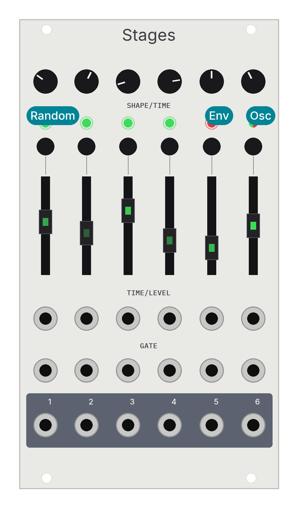

**Cirrostratus Stages** is a new mode for Mutable Instruments **Stages**, built on
[BRIBESTAGES](https://github.com/thisisbribery/bribestages) (qiemem's bipolar
firmware plus segment linking, envelope followers and sync LFOs).

In Cirrostratus Stages every one of the six segments is its own instrument. Tap a
segment's button and it becomes the next type:

| Light | Type | What it is |
|---|---|---|
| green | **Random** | slewed random voltages: 7 kinds, and the weather |
| yellow | **Chaos** | patterned randomness: Turing loop, logistic map, Lorenz, cellular automaton, coin gates, dust, a stair row |
| red | **Envelope** | attack *and* decay in one segment, with curve, loop and ratchets |
| green/red | **Oscillator** | 8 audio oscillators, including a 16-wave bank, additive, Gendy and a wave-rider |
| yellow/red | **Processor** | CV: envelope follower, transient gate, slew, crush/fold, gesture looper, quantiser, sample and hold, comparator |
| green/yellow | **Effect** | audio: the segment on the left through a filter, VCA, ring modulator, comb, chorus, echo, drive or lo-fi |

Every type has several **flavours**, and every segment remembers its own
flavour, settings and extra options for each type.

Segments can also take each other's outputs through **cords**, the same
kinds as in Sleepcousonique (section 10), and the whole panel can **dream**
when you leave it alone (section 11).

**New in 1.3.1:** a new name: this was **fletchfoorth**, and it is now
**Cirrostratus Stages**, in one place with Cirrostratus for the Monsoon
(nothing on the module changes; your settings are kept). And the overload light fired on the module, so this version
gives the engine more room and lets you see how busy the chip is. The audio
now runs up to three blocks ahead instead of one (0.8 ms instead of 0.26 ms),
so a block that runs long borrows time from the others; a block is only
missed when the chip is out of time on average. And there is a **load meter**:
hold buttons 5 and 6 together for a second and the slider lights show how
much of the chip's time the engine uses, read from the chip's own cycle
counter (section 14). The light no longer flickers when you change a type or a
flavour: that was the settings save, not the engine. Your settings are kept.

**New in 1.3:** the oscillators are cleaner still, and the whole engine is
lighter. Morph and the wave bank now keep everything that isn't the note
60 to 70 dB below it across the slider. The wave bank's top table was the
last source of grit at low notes, so the bank now stops at 128 harmonics
(the lowest notes are a touch less airy), and every octave's table has 8 to
16 points per harmonic. Cirrostratus Stages also needs about a quarter less CPU
(the heaviest set of segments went from 1,512 to 1,156 instructions a
sample). If the module ever does run out of time, the **button lights
flicker red** for a moment (section 14). Your settings are kept.

**New in 1.2:** cleaner oscillators. Morph, the wave bank and Fold no longer
alias (the grainy, "low-res" edge at higher notes): the wave bank is now
stored band-limited, one table per octave, and Morph reads the same tables;
Fold runs at twice the rate; every oscillator's pitch glides smoothly within
each block instead of stepping. Your settings are kept.

**New in 1.1:** the Effect type, three CV processors (quantiser with
Sleepcousonique's 38 scales, sample and hold, comparator), the Weather and the
Stair row, Gendy rows, cords, dream drift. 1.0's Cirrostratus Stages settings start
fresh once (the settings grew).

Everything BRIBESTAGES does still works in its own modes. Cirrostratus Stages is one
more mode next to them.

---

## 1. Installing

The module updates from an audio file. The updater is built in and can't be
damaged by a failed attempt, so you can always try again.

**Where:** the Cirrostratus releases page,
github.com/femifleming/cirrostratus/releases, or the repository's
`cirrostratus-stages/firmware/` folder. (It used to be fletchfoorth, with its own repository; since 1.3.1 it
lives in Cirrostratus, next to the Monsoon firmware.)

**You need:** a computer or phone with a headphone jack (a wired USB headphone
adapter works, Bluetooth doesn't), a 3.5 mm patch cable, and
`cirrostratus-stages-v1.3.1.wav` (or `cirrostratus-stages-v1.3.1-flipped.wav` for a module mounted
upside down).

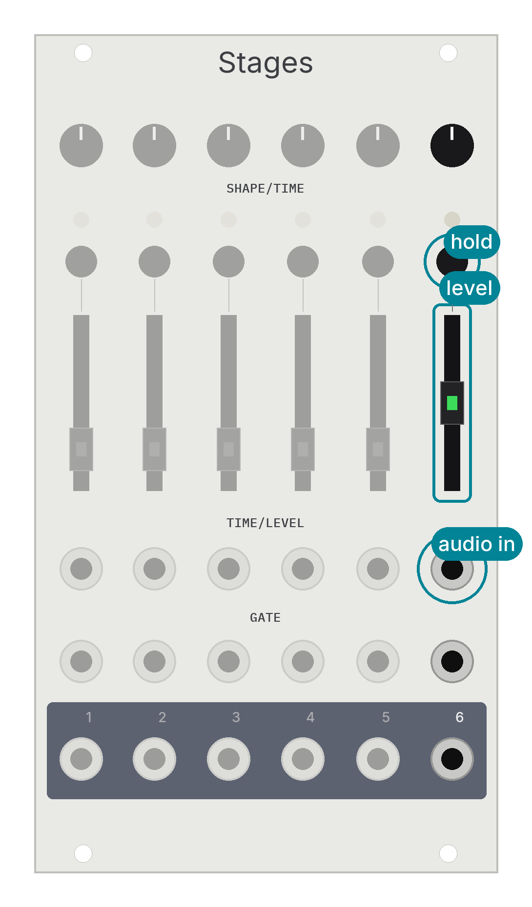

1. Power the rack off. Unplug every cable from the Stages.
2. Patch the headphone out into the **CV input of segment 6** (top row of jacks,
   rightmost).
3. Set **slider 6 to the middle**. It sets the input gain.
4. Hold **button 6** and power the rack on. Slider 6's light blinks green: the
   module is waiting for audio.
5. Set the volume high. Turn off sound effects, EQ and notifications.
6. Play the .wav from the start. The six button lights are a level meter:
   **3 or 4 lit is right**. Move slider 6 to get there.
7. Green slider lights run left to right while it loads (about 80 seconds).
8. When the file ends, the module restarts on the new firmware.

**All six button lights blink red:** the level was too low or the audio cut
out. Press button 6, raise slider 6, and play the file again from the start.

**Your settings:** BRIBESTAGES and qiemem settings (segment types, links,
mode) are kept. Cirrostratus Stages keeps its own settings in a separate corner of
the memory, so switching modes never disturbs either. To go back, flash
BRIBESTAGES or qiemem the same way.

---

## 2. Getting into Cirrostratus Stages

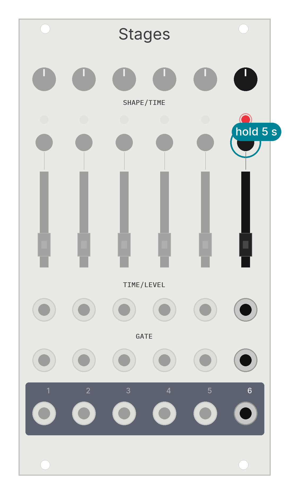

**Hold button 6 for 5 seconds.** The lights show the mode, and the module
starts in Cirrostratus Stages. It remembers the mode through power cycles.

The first time, the segments are what you probably want anyway: **1–4 Random,
5 Envelope, 6 Oscillator**.

**To leave:** hold another button for 5 seconds, as in every Stages mode:

| Hold for 5 s | Mode |
|---|---|
| button 1 | Stages (segment generator) |
| button 2 | Advanced |
| button 3 | Slow LFO |
| button 4 | 6EG |
| button 5 | Ouroboros. **Hold button 5 again** while in Ouroboros: Ouroboros alternate (and back) |
| button 6 | **Cirrostratus Stages** |

Ouroboros alternate used to have button 6; it is now behind a second hold of
button 5, so no mode was lost.

When you leave Cirrostratus Stages, the other modes start fresh (their settings are
kept; a running loop or LFO simply restarts).

---

## 3. One segment, every control

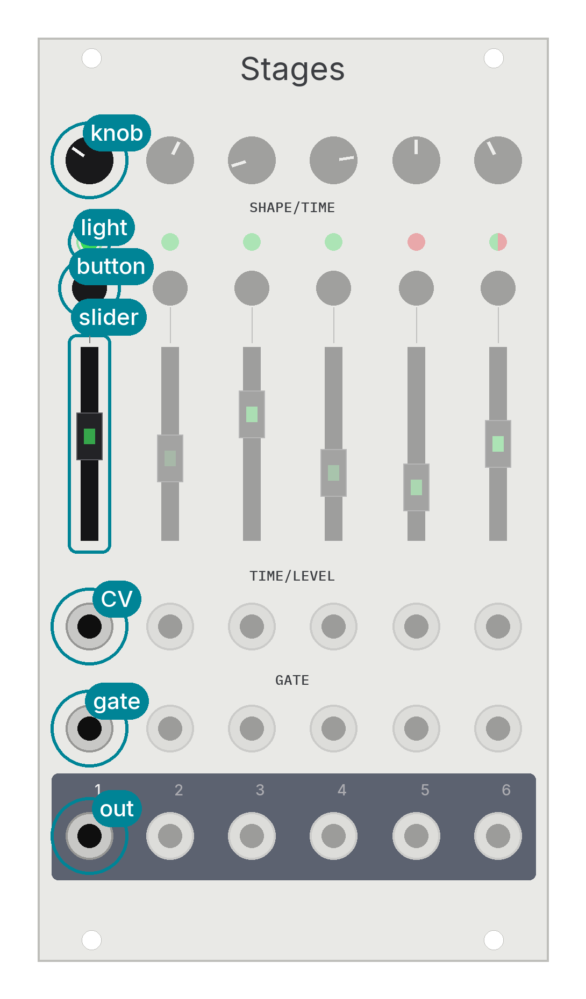

Each segment works the same way, whatever its type:

| Control | Does |
|---|---|
| **Slider** (+ the CV jack, + a cord) | the main control: rate, pitch, attack… (each type below). A cord from the left neighbour adds to the CV jack (section 10) |
| **Knob** | the second control: slew, timbre, decay… |
| **Gate jack** | clock, trigger, sync, freeze or record, depending on the type |
| **Out jack** | the segment's output |
| **Button light** | the type (its colour), a bright flash on every tick or hit, breathing when the extra option is on |
| **Slider light** | the output level |

### The button

| Gesture | Does |
|---|---|
| **Tap** | next type: Random → Chaos → Envelope → Oscillator → Processor → Effect → Random |
| **Hold + move the slider** | choose the **flavour** (the slider is cut into as many zones as the type has flavours; bottom = 1) |
| **Hold + turn the knob** | set the type's **hidden setting** (amplitude, curve, fine tune, gain…). The slider light shows its value while you turn |
| **Hold ½ to 5 s, release** | toggle the type's **extra option** (bipolar, loop, voice, invert…) |
| **Hold 5 s** | mode change (section 2) |
| **Hold + tap the button on its left** | the **cord** into this segment: none → hall → fog → water → door → range → maybe (section 10) |
| **Hold both + turn this knob** | the cord's **amount**, −1 to +1 |
| **Buttons 1 and 2 together, 2 s** | **dream drift** on or off (section 11) |
| **Buttons 5 and 6 together, 1 s** | **load meter** while you hold them: the slider lights fill from slider 1, each a sixth of the chip's time (section 14) |

While you hold a button, its slider and knob are frozen: moving them sets the
flavour and the hidden setting without changing the sound. When you let go,
they glide back to where they really are over up to a second.

Settings are saved when you let go of all buttons.

### Reading the flavour

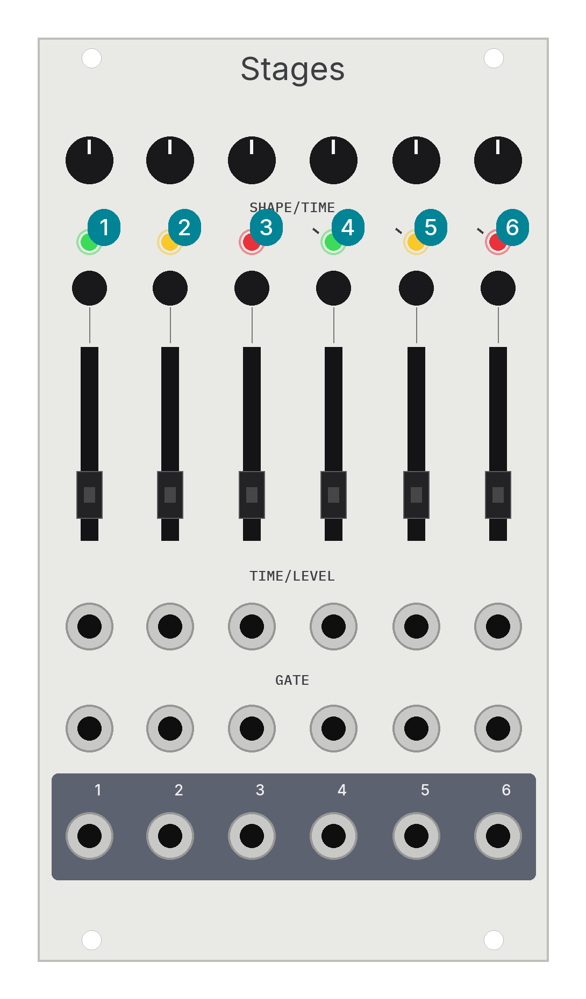

While you hold a button, its light shows the segment's flavour:

| Flavour | Light |
|---|---|
| 1 | green |
| 2 | yellow |
| 3 | red |
| 4 | green, blinking |
| 5 | yellow, blinking |
| 6 | red, blinking |
| 7 | green and red, alternating |
| 8 | yellow and red, alternating |

---

## 4. Random (green)

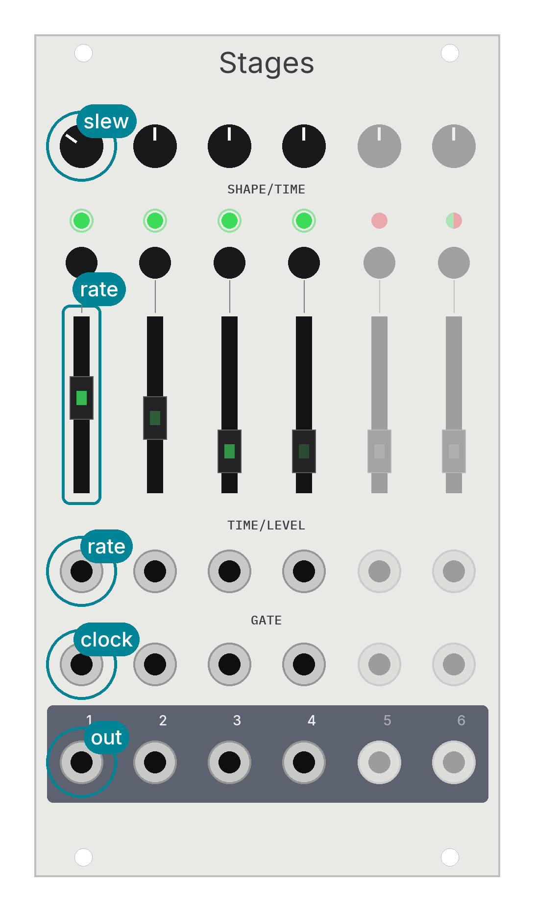

Slewed random voltages, one per segment, each with its own kind of
randomness.

| Control | Does |
|---|---|
| Slider + CV | **rate**: 0.05 Hz at the bottom, about 2 Hz at noon, 100 Hz at the top |
| Gate jack | **clock**: with a cable in, a new value comes on every rising gate, and the slider becomes the **chance** of a new value (top = every clock, bottom = never: the value is locked) |
| Knob | **slew**: fully left = clean steps; turning right, each new value glides in over more of the time until the next one |
| Hold + knob | **amplitude** (output level), full by default |
| Extra option (hold ½ s) | **bipolar**: −5 to +5 V instead of 0 to 8 V |

| # | Flavour | What it does |
|---|---|---|
| 1 | **Uniform** | any value, all equally likely |
| 2 | **Gaussian** | mostly near the middle, sometimes far out |
| 3 | **Walk** | a random walk between two walls (Xenakis): it wanders and bounces instead of jumping |
| 4 | **Pink** | 1/f drift: slow wandering with occasional leaps, the way natural things move |
| 5 | **Quantised** | whole semitones, 0 to 5 V at 1 V/oct. Hold + knob sets the range: 1 to 5 octaves. Bipolar shifts it down 2.5 V |
| 6 | **Kin** | stays close to the segment on its left; the knob is how loosely (the slew is fixed and gentle) |
| 7 | **Orbit** | a point moving along a path. The knob morphs the path: circle → figure 8 → spiral → wandering. The slider is its speed. Side by side, Orbit segments read the same point: the first gives **X**, the next **Y**, the third the **distance** from the centre |
| 8 | **Weather** | a sky. Pressure fronts come and go; low pressure brings gusts of wind, and rain when the air is damp. The slider is how fast the weather moves (at the top, a storm a second; at the bottom, a front every few minutes). One segment gives the sky: pressure with its gusts. Side by side, weather segments read one sky: the **sky**, the **wind**, the **rain** (5 ms triggers, their heights random), the **humidity**, the **pressure** alone |

Four Random segments with different flavours make four voltages that move in
four different ways from one gesture of your hand.

---

## 5. Chaos (yellow)

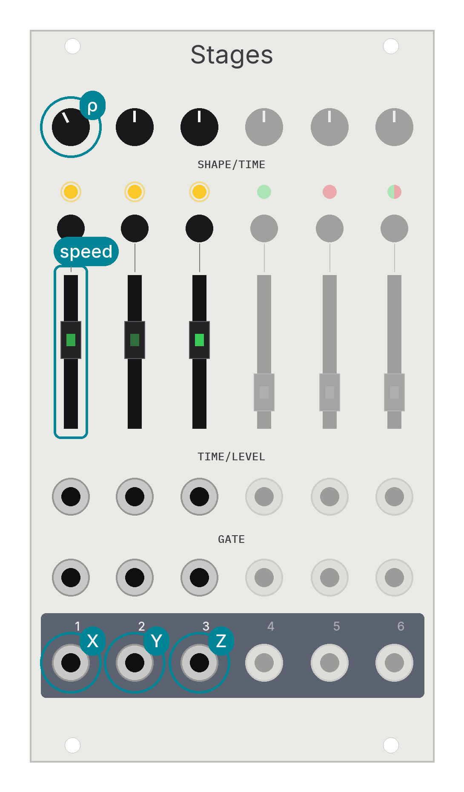

Randomness with a shape you can lock, push and listen to.

| Control | Does |
|---|---|
| Slider + CV | **rate** (0.05 to 100 Hz), or the gate jack as a **clock** |
| Knob | depends on the flavour (below) |
| Hold + knob | **amplitude** |
| Extra option | **bipolar** (not for the gate flavours) |

| # | Flavour | Knob | What it does |
|---|---|---|---|
| 1 | **Turing loop** | left = locked, middle = random, right = locked and flipping every pass | an 8-step loop of bits that you can freeze, mutate or break. Fully right it plays its 8 steps, then their opposite: a loop twice as long |
| 2 | **Logistic map** | r from 3.4 to 4.0 | one knob from order to chaos: fully left it settles into a 2-step pattern, a little to the right it doubles to 4, 8, 16 steps, and from about a quarter of the way it never repeats |
| 3 | **Lorenz** | ρ from 20 to 50 | the butterfly. Slider = speed. Fully left it slowly settles; from about a sixth of the way it never does. Side by side, Lorenz segments read one attractor: **X**, **Y**, **Z** |
| 4 | **Cellular** | the rule: 30, 90, 110, 150, 184, 45, 73, 54 | a cellular automaton, 8 cells per segment. Side by side, the segments share one ring of cells; each segment outputs its 8 cells as a stepped voltage. Clocked by the first segment of the row |
| 5 | **Coin gates** | chance of heads | a coin toss per clock: heads opens the gate for half a clock. Outputs 0 or 8 V (times the amplitude) |
| 6 | **Dust** | how random the heights are | triggers (5 ms) at random moments, no clock. The slider sets how many: from 0.1 to 50 a second (at the top, triggers closer than 5 ms merge, so about 40 land) |
| 7 | **Stair** | the chance this step plays | a row of Stair segments is one stepped sequence (below) |

### The stair row

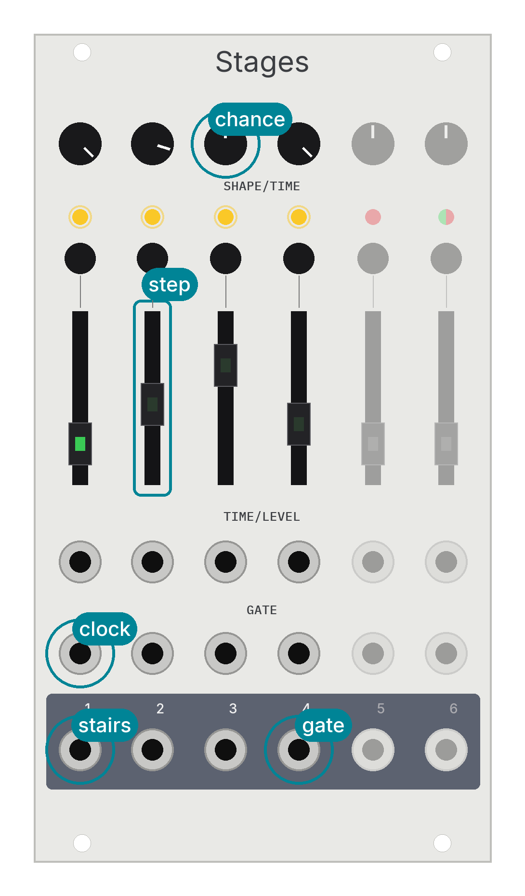

Put two to six Stair segments side by side. Each **slider** (+ its CV, and its
cord) is the height of its step, each **knob** the chance its step plays: a
step that loses the roll is skipped, so the knobs turn a fixed pattern into a
changing one. The **first** segment's gate jack is the clock; with no clock
its knob is the speed (0.25 to 16 steps a second) and its own step always
plays. The first segment outputs the **stairs**; every other one outputs a
**gate** (8 V) while its step is on: trigger an envelope from step 3 only.

---

## 6. Envelope (red)

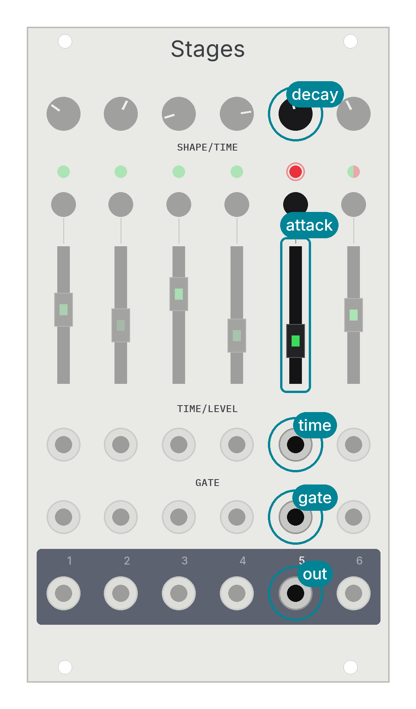

Attack and decay in one segment: no more patching two segments together.

| Control | Does |
|---|---|
| Slider | **attack**, 1 ms to 10 s |
| Knob | **decay**, 1 ms to 10 s |
| CV jack | **time**: +1 V makes both twice as fast, −1 V twice as slow |
| Gate jack | a **trigger** plays attack then decay; a **gate held** past the attack stays at the top until you let go, then decays |
| Hold + knob | **curve**. Noon: straight lines. Left: snappy, moving fast at the start and easing in. Right: slow to start, fast at the end |
| Extra option | **loop**: with no gate cable it cycles by itself; with a gate it loops while the gate is high |

Output: 0 to 8 V. Every new trigger starts the attack from wherever the
envelope is, so retriggering never clicks.

| # | Flavour | What it does |
|---|---|---|
| 1 | **Once** | one hit per trigger |
| 2 | **Twice** | a ratchet: two hits per trigger |
| 3 | **Three times** | three hits |
| 4 | **Four times** | four hits |

Ratchets play their hits back to back at the attack and decay you set; they
don't hold for a long gate.

---

## 7. Oscillator (green/red)

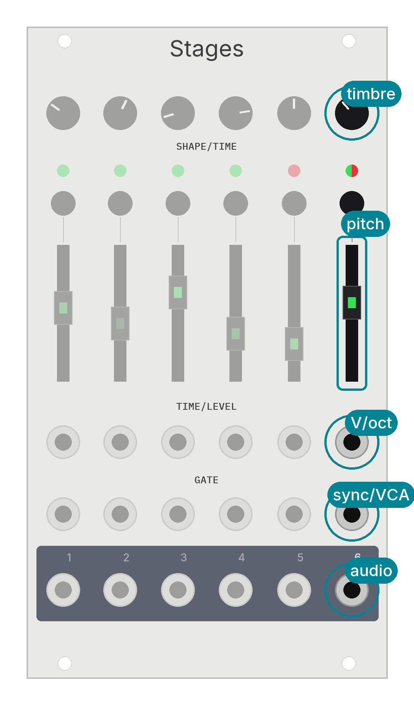

Audio oscillators, ±5 V. Several are inspired by the SDS Digital SDS VCO
(a bank of selectable waveforms, a built-in envelope and VCA, recorded
waveforms).

| Control | Does |
|---|---|
| Slider | **pitch**: C1 (33 Hz) at the bottom to C7 (2093 Hz) at the top |
| CV jack | **1 V/oct** pitch |
| Knob | **timbre** (per flavour, below) |
| Gate jack | **hard sync** (restarts the wave), or with the extra option the voice's gate |
| Hold + knob | **fine tune**, ±1 semitone (noon = in tune) |
| Extra option | **voice**: a built-in envelope and VCA. The gate opens it (2 ms attack), letting go fades it (0.3 s). With no gate cable the voice stays open |

| # | Flavour | Knob | Sound |
|---|---|---|---|
| 1 | **Morph** | sine → triangle → saw → square → narrow pulse | the classic shapes, smoothly in between, band-limited: clean up to the top of the slider |
| 2 | **Wave bank** | scans 16 waveforms, crossfading | sine, triangle, saw, square, pulse 25 %, pulse 10 %, half sine, full-wave sine, pinched sine, 4 steps, 8 steps, formant, sync saw, frozen noise, sine + octave, organ. Every wave is stored band-limited, one table per octave (up to 128 harmonics), so even the hard-edged ones stay clean at high notes |
| 3 | **Additive** | 1 to 16 harmonics | from a pure sine to a bright, saw-like stack. Harmonics above 14 kHz are left out, so high notes stay clean |
| 4 | **Pair** | second sine from unison to a fifth above | two sines; between them your ear hears a third, lower tone (difference tones, as in the Oneirophone) |
| 5 | **Fold** | fold depth | a sine through a wavefolder: from round to glassy. Folded at twice the rate, and the depth eases off in the top octave so the folds don't turn to grit |
| 6 | **FM** | modulation depth | the segment on the **left** is the modulator: another oscillator gives FM; a random or envelope bends the phase slowly. Segment 1 has no left neighbour: a plain sine |
| 7 | **Gendy** | how far the waveform wanders | Xenakis' dynamic stochastic synthesis: 12 points whose heights and spacing take a random walk every cycle. Left: a steady tone; right: a living, unstable one. **Gendy row:** side by side, Gendy segments play the first one's points, each at its own pitch: one waveform moving as a cloud of voices (the first one's knob is the wander) |
| 8 | **Rider** | how long one rewrite takes (0.05 to 10 s) | the wave-rider: it records the segment on its **left** into its own waveform as it plays (segment 1 records its CV jack). The gate held high freezes the waveform |

---

## 8. Processor (yellow/red)

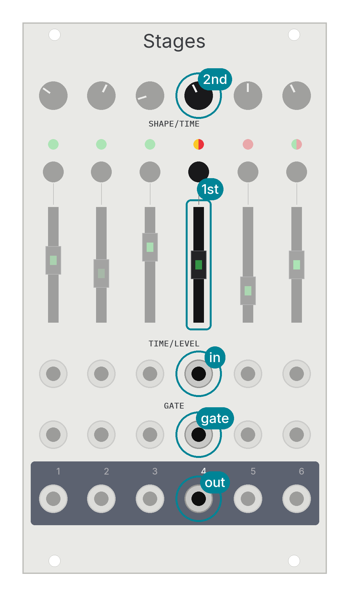

The CV jack becomes an input. Stages reads it about 3,900 times a second, so
audio comes in lo-fi: that's part of the sound. Here the slider works alone
(the CV jack is the input, not a modulation). A cord into a Processor adds
the left neighbour to that input: a hall cord from a Random into a Quantise
is a melody with no cables. For audio at the full rate, use an Effect
(section 9).

| # | Flavour | Slider | Knob | Hold + knob | Gate | Extra option |
|---|---|---|---|---|---|---|
| 1 | **Follow** | release, 5 ms to 5 s | attack, 0 to 250 ms | input gain ×1 to ×8 | high = freeze | invert (0 to −8 V) |
| 2 | **Transient** | threshold (bottom = most sensitive) | trigger length, 2 to 100 ms | input gain ×1 to ×8 | – | invert (5 V, dropping to 0 on hits) |
| 3 | **Slew** | rise time, 0 to 5 s | fall time, 0 to 5 s | – | high = hold | invert |
| 4 | **Crush/fold** | drive ×1 to ×8 into a folder | rate: each reading held 1 to 32 times (3.9 kHz down to 122 Hz) | output level | high = freeze | invert |
| 5 | **Looper** | speed ¼× to 4× (noon = 1×) | smoothing | – | high = **record**, low = play | backwards |
| 6 | **Quantise** | transpose, −2 to +2 octaves (five zones) | the **scale**: Sleepcousonique's 38 (below) | the root, C to B | a new note only on each rising gate | a trigger on every new note instead of the pitch |
| 7 | **Hold** | rate of the internal clock when no gate is patched, 0.05 to 100 Hz | glide to the new value, 0 to 1 s | – | sample on each rising gate | track and hold: follows while the gate is high |
| 8 | **Compare** | the level, −5 to +8 V | hysteresis, 0 to 1 V | the gate's height, 5 to 8 V | – | window: open while the input is within the knob's distance of the level |

- **Follow** is the BRIBESTAGES envelope follower: 0 to 8 V; at ×1 a 5 V audio
  peak gives full output.
- **Transient** fires a 5 V trigger when the input jumps (a drum hit, a
  pluck), at most one every 48 ms. Patch a drum loop in and trigger
  envelopes from it.
- **Looper** records the CV jack 64 times a second, up to 12 seconds, while
  the gate is high, then loops it when the gate goes low. Before anything is
  recorded, and while recording, the input passes straight through. A new
  gate records over it.
- **Quantise** uses the CV jack at 1 V/oct and the same 38 scales as
  Sleepcousonique, in the same order, turning the knob from left to right: just
  major, just minor, just pentatonic, otonal 8–15, utonal, chromatic, major,
  minor, dorian, phrygian, lydian, mixolydian, locrian, harmonic minor,
  melodic minor, major and minor pentatonic, blues, whole tone, diminished,
  then 24-, 19-, 22-, 31- and 53-TET, Bohlen-Pierce and the rest of
  Sleepcousonique's list. Scales that aren't 12-tone (Bohlen-Pierce repeats at
  3:1, not the octave) work in cents, so the notes are exact.

---

## 9. Effect (green/yellow)

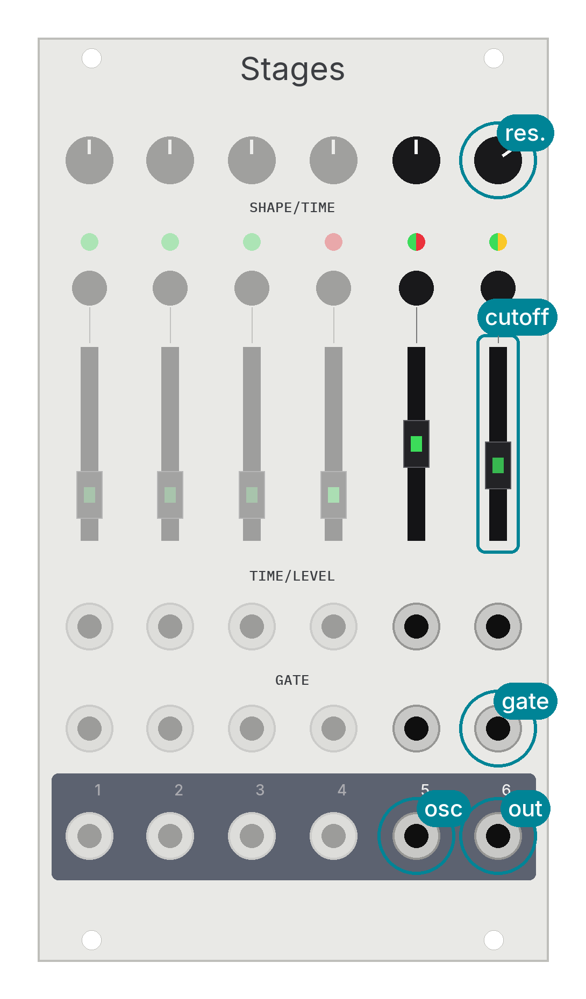

Audio processing of the segment on the **left**, sample by sample at the full
rate (31,250 a second), so an oscillator → filter → VCA across three segments
sounds clean. Segment 1 has no left neighbour: it takes its own CV jack
(read 3,900 times a second, lo-fi). Everywhere else the CV jack modulates the
main control.

| # | Flavour | Slider + CV | Knob | Hold + knob | Gate | Extra option |
|---|---|---|---|---|---|---|
| 1 | **Filter** | cutoff, 20 Hz to 13 kHz, 1 V/oct | resonance, up to ringing | low-pass → band-pass → high-pass | – | drive into the filter |
| 2 | **VCA** | level (unity at the top) | decay of the gate's envelope, 5 ms to 5 s | the response, linear → exponential | opens it (2 ms attack), letting go decays | low-pass gate: it darkens as it closes |
| 3 | **Ring** | the carrier's pitch, C1 to C7, 1 V/oct | dry → ring modulated | carrier sine → square | – | the carrier is the CV jack (another sound, lo-fi) |
| 4 | **Comb** | its pitch, C1 to C7, 1 V/oct (41 Hz lowest) | feedback: how long it rings | damping | – | negative feedback: hollow, an octave down |
| 5 | **Chorus** | speed, 0.05 to 8 Hz | depth | feedback: towards a flanger | – | vibrato (only the moving copy) |
| 6 | **Echo** | time, up to 0.19 s | feedback | dry → wet | – | hold: what's in it repeats for ever |
| 7 | **Drive** | drive, ×1 to ×16 | soft clip → wave folder | output level | – | asymmetric: even harmonics |
| 8 | **Lo-fi** | sample rate, 31 kHz (bottom) down to 100 Hz (top) | bits, 16 down to 2 | output level | – | the rate jitters |

The comb, chorus and echo use the segment's own looper memory, so a segment
can be one of those or a looper, not both at once (it is a different type
anyway). The echo stores its sound 3,900 times a second: warm and dark,
like a small tape.

---

## 10. Cords

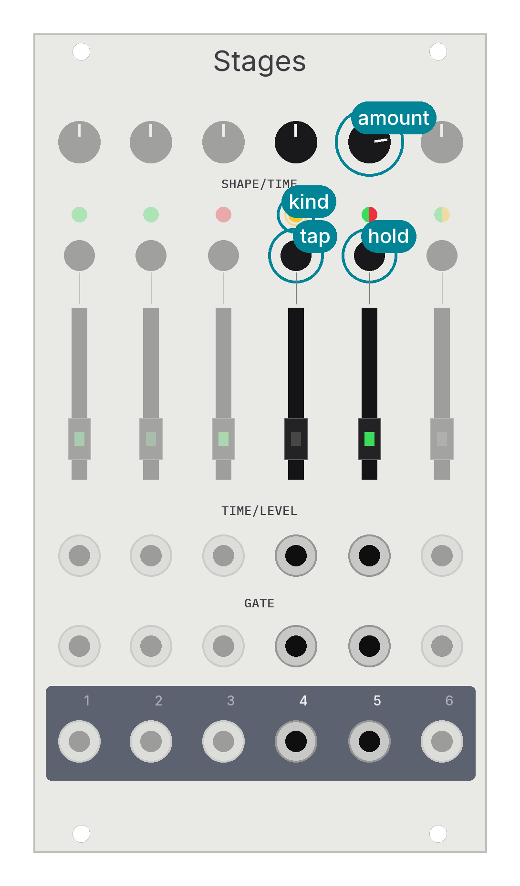

A cord takes the output of the segment on the **left** into a segment's
**CV input**, as if a patch cable ran there (added to whatever is plugged
in). Segment 1's left is segment 6: the row is a ring. The cords are
Sleepcousonique's:

| Kind | Light (on the left button, while you hold this one) | What gets through |
|---|---|---|
| none | off | nothing (as before) |
| **hall** `->` | green | a plain wire |
| **fog** `~>` | yellow | softened: edges rounded over 8 ms |
| **water** `=>` | red | a capacitor: slow to fill, slow to drain (60 ms) |
| **door** `>|` | green, blinking | a diode: only what is above 0 V |
| **range** | yellow, blinking | the neighbour's swing as 0 to the amount, whatever its polarity (a ±5 V sound becomes 0 to +8 V) |
| **maybe** `?>` | red, blinking | each time the neighbour rises through the middle of its swing, the dice roll: it gets through, or stays silent until the next rise |

**Set one:** hold the segment's button and **tap the button on its left**:
each tap steps to the next kind. **Amount:** hold both buttons and turn the
held segment's knob: −1 (upside down) to +1, noon = nothing; the slider light
shows it. A new cord starts at +1.

What the cord does depends on what the CV jack does: an oscillator's pitch
(1 V/oct: +1 V from the left is an octave), a random's rate, a filter's
cutoff, a processor's input. A random into an oscillator through a **maybe**
is a melody with holes in it.

---

## 11. Dream drift

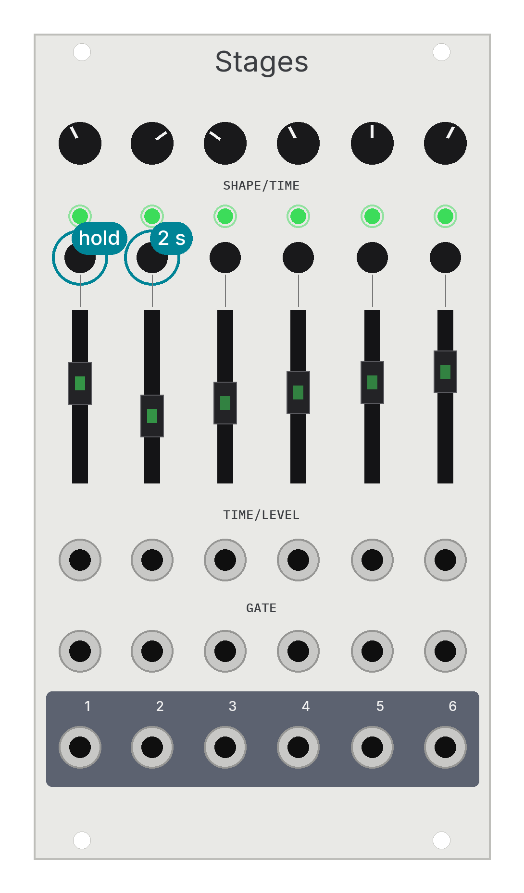

**Hold buttons 1 and 2 together for 2 seconds** to turn dream drift on (all
lights flash green) or off (red).

With it on, the panel watches your hands. A minute after the last time you
touched a slider, a knob or a button, every segment's slider and knob start
to wander on a slow Lorenz attractor (each segment its own mix of its three
axes), fading in over 30 seconds, up to a sixth of their travel: the patch
keeps being itself, but slowly dreams. Touch anything and it comes back to
where you left it in half a second.

---

## 12. Neighbours

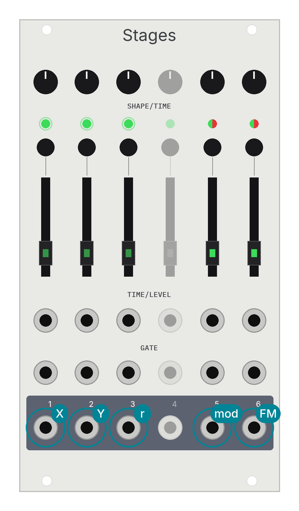

Some flavours listen to the segment on their **left**, or work as a team
when neighbours share a type **and** a flavour:

| Flavour | With its neighbours |
|---|---|
| Random 6 **Kin** | follows the segment on its left, loosely |
| Random 7 **Orbit** | side by side: X, Y, distance from the centre of one moving point |
| Chaos 3 **Lorenz** | side by side: X, Y, Z of one attractor |
| Chaos 4 **Cellular** | side by side: one ring of cells, 8 per segment |
| Oscillator 6 **FM** | the left segment is its modulator |
| Oscillator 8 **Rider** | records the left segment as its waveform |
| Random 8 **Weather** | side by side: sky, wind, rain, humidity, pressure of one sky |
| Chaos 7 **Stair** | side by side: one stepped sequence (section 5) |
| Oscillator 7 **Gendy** | side by side: one waveform at several pitches |
| every **Effect** | processes the segment on its left |
| any segment with a **cord** | hears the segment on its left through it (section 10) |

A row starts at its leftmost segment: that one's slider, knob and gate run
the row.

---

## 13. Recipes

**Your usual set.** Segments 1–4 Random (tap until green), 5 Envelope, 6
Oscillator. For a bipolar random, hold its button ½ s. For four different
motions, give each a different flavour: Uniform, Walk, Pink, Orbit.

**A whole voice from two segments.** Segment 5 Random, flavour 5 (Quantised)
→ patch its out into **CV 6**. Segment 6 Oscillator with the voice option on,
a clock into **gate 5 and gate 6**. Every clock: a new note, played through
the built-in VCA.

**Drums triggering envelopes.** A drum loop into **CV 4**, segment 4
Processor, flavour 2 (Transient). Its out into **gate 5**, segment 5 an
Envelope with a short decay. The envelope now follows the kick.

**The butterfly.** Segments 1–3 Chaos, flavour 3 (Lorenz) each. Outputs 1–3 are
X, Y and Z of one attractor: three related, never-repeating voltages.

**A wave drawn by chance.** Segment 5 Random (Walk, slew up), segment 6
Oscillator flavour 8 (Rider). The random's motion becomes the oscillator's
waveform, slowly changing as it rides.

**FM bells.** Segment 5 Oscillator (Morph, a sine), segment 6 Oscillator
flavour 6 (FM), both tuned with their sliders. Knob 6 is the FM depth.

**A voice across three segments.** Segment 4 Oscillator (Morph), segment 5
Effect 1 (Filter), segment 6 Effect 2 (VCA). A clock into **gate 6**, an
envelope's out into **CV 5** for the cutoff. Oscillator → filter → VCA, at
the full rate, no cables between them.

**Tuned randomness.** Segment 3 Random (Walk), segment 4 Processor 6
(Quantise) with a **hall** cord from 3 (hold 4, tap 3), the knob on a scale.
Out 4 is a melody in that scale. For just intonation turn the knob fully
left; Bohlen-Pierce sits about two-thirds of the way round.

**Rain on a drum.** Segments 1–3 Random 8 (Weather), slider up. Out 3 is the
rain: patch it into a drum or an envelope's gate. Out 2, the wind, into a
filter's cutoff.

**The stair with holes.** Segments 1–4 Chaos 7 (Stair), a clock into gate 1.
Sliders = the notes, knobs = the chance of each. Out 1 into an oscillator's
CV; out 3 opens the VCA only on step 3.

**Play it back.** A hand-played CV (a joystick, a ribbon) into **CV 4**,
segment 4 Processor flavour 5 (Looper). Hold a gate high while you play, let
go: your gesture loops.

---

## 14. Under the hood

| | |
|---|---|
| Output | −8 to +8 V at most; randoms 0 to 8 V or ±5 V; oscillators and effects ±5 V; chaos and stair gates 8 V (times the amplitude); transient, compare and quantise triggers 5 V (compare up to 8 V) |
| Processing | 31,250 samples a second per segment (Effects process their left neighbour at that rate); CV and knobs read 3,906 times a second; cords once per block (3,906 a second) |
| CPU | measured on an emulated Cortex-M4: 651 instructions per sample for the default set, 1,156 for the heaviest (six Fold or six Morph oscillators), 1,108 for six effects (six choruses); no single block above 1,220, with the controls jittering as the module's inputs do; the chip has 2,304 cycles per sample, and running from flash it needs more than one cycle per instruction |
| Overload light | if the processing ever misses its deadline (the DAC would play a stale block: a gritty, chopped sound), all six **button lights flicker red** for half a second. (Not for the moment after a settings save: every change is saved to flash when you let go of the button, and the chip can't run anything while it writes flash, so a block or two goes missing there, as on stock Stages.) If you see it, the set of segments is too heavy for the chip: please report which types and flavours were running, and what the load meter shows |
| Load meter | hold buttons 5 and 6 together for 1 s: the slider lights show the share of the chip's time the engine uses (interrupts that land in it included), measured with the chip's own cycle counter over the last 65 ms. Each light is a sixth; the last lit one glows dimmer for a part. All six full = out of time |
| Buffering | the engine runs up to three blocks of 8 samples ahead of the outputs (0.8 ms), so one slow block doesn't miss its deadline (Stages had one block) |
| Memory | Cirrostratus Stages uses the memory the normal Stages engines use; they rest while it runs (16.7 KB of their 23.6 KB); the wave bank is in flash: 16 waves × 8 band-limited octave tables, 69 KB |
| Settings | stored in their own flash pages (the last 4 KB), untouched by firmware updates and by the other modes |
| Chaining | each module runs its own six segments; Cirrostratus Stages doesn't chain |
| Tests | 713 host checks on the real engine code (pitch, V/oct, envelope times, rates, ranges, every flavour; scales to the cent, filter, ring, comb pitch, echo time, every cord, the stair, the weather, Gendy rows, dream drift; the wave bank's tables and, by FFT at C2, C4 and C6, how far below the notes everything between the harmonics sits; a storm of every type, flavour and option with cords and thrown controls) and a check that the update file decodes to exactly the firmware |

Cirrostratus Stages runs on real Stages modules: the overload light and the load
meter came out of the first runs on one (1.2 to 1.3.1), and every version is
also tested on the computer and on an emulated processor first.

---

## 15. Thanks and licences

- **Mutable Instruments / Émilie Gillet**: Stages, stmlib and the audio
  bootloader (MIT).
- **qiemem**: the bipolar multi-mode firmware this is built on (MIT).
- **BRIBESTAGES**: segment linking, envelope followers and sync LFOs (MIT).
- **SDS Digital SDS VCO**: the inspiration for the wave bank, the voice option
  and the wave-rider.
- **Iannis Xenakis**: the random walk and Gendy.

Cirrostratus Stages is MIT-licensed, and part of Cirrostratus
(github.com/femifleming/cirrostratus, folder `cirrostratus-stages/`).
