# Cirrostratus

### *a thin, high sheet of cloud for the Monsoon*

**Version 1.5.0**

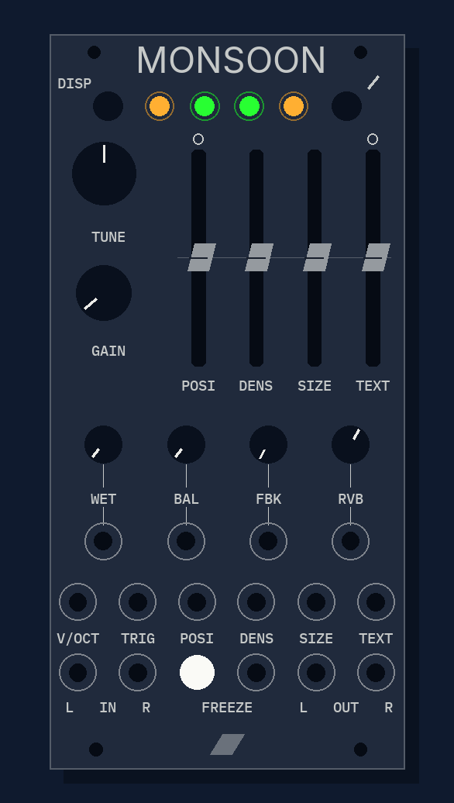


> **cir·ro·stra·tus** /ˌsɪroʊˈstreɪtəs/ *n.* — a pale veil of ice crystals
> spread so high and thin across the sky that the sun shines straight
> through it, with a ring of light around it: a **halo**.

Cirrostratus is alternative firmware for **Monsoon**, Jak Plugg's 12HP
module built on Mutable Instruments' Clouds. Clouds made granular weather.
This firmware goes one layer higher, thinner and brighter:

- **29 modes** in two banks (Clouds had four kinds of sky)
- **seven controls of their own in every mode**: the four sliders plus the
  three small knobs **BAL**, **FBK** and **RVB**, which mean something
  different (and specific) in each mode. That's 87 extra controls, all with
  CV
- **48 kHz**, 32-bit float inside, 16-bit block-float buffers that keep quiet
  sounds clean (a −60 dB whisper is stored with 93 dB SNR), and a
  **buffer quality** setting that trades fidelity for up to **6× longer
  buffers** in every mode that records, and an **FFT size** setting
  (256 to 2048 points) for every spectral mode
- a clean **output section**: equal-power blend, hard stereo (whatever the
  mode makes), **bass kept mono below 60 Hz**, a transparent limiter and
  dithered output
- four **save slots**, **slot morphing**, per-mode **options** and
  **envelope-follower routing**

It is still your Monsoon: same panel, same jacks, same bootloader. Only the
weather changes.

**New in 1.5.0:** **GRAINS is gone.** Mode 1 is retired and every other
mode keeps its number, so bank 1 now runs from 2 to 15 (POSITION's bottom
end lands on 2 · SPECTRAL), and your settings, calibration and save slots
all carry over. A module that was sitting in GRAINS wakes up in SPECTRAL;
a slot saved from GRAINS is simply skipped. Every remaining mode and option
was then put through a long check on an emulated STM32F405 built exactly
like the firmware: each one at ordinary settings, flat out, fully dry
(the input comes through within 1 LSB in every mode) and at all 16 corners
of the panel. That turned up two old overloads, now fixed: **CHLOE**'s
PT2399 and BBD engines at short delays (SIZE below ~60 % on the PT2399,
below ~27 % on the BBD) needed up to three times the time the
module has, and **TAPE** at its very fastest (×4) was over too. CHLOE's
emulated chips now stop raising their clock there and use a shorter line
instead (same delay time; short PT2399 echoes are a little darker), and
TAPE now tops out at ×3.

**1.4.0:** an **FFT size** page (hold DISP, tap FREEZE; section
3.8) sets the resolution of all seven spectral modes at once: 256 points
for sharp, grainy, transient spectra up to 2048 for smooth, glassy ones,
or each mode's own size as before. Blur, decay and delay times stay the
same at every size; only the resolution changes.

**1.3.1:** the buffer page opens however long you've held WRITE, and
shows itself clearly (3.7).

**1.3.0:** SPECTRAL has a second option, **SMEAR**, the spectral
smear from Sleepcousonique's Wingie mode (section 5, mode 2). RESONATOR,
PLATES and GAMELAN no longer retune on the tiny wobble every knob has, which
made RESONATOR glitch and stop answering the mode menu; and if a mode ever
runs out of time, it drops out for a moment instead of locking the panel.

---

## 0. Forecast in thirty seconds

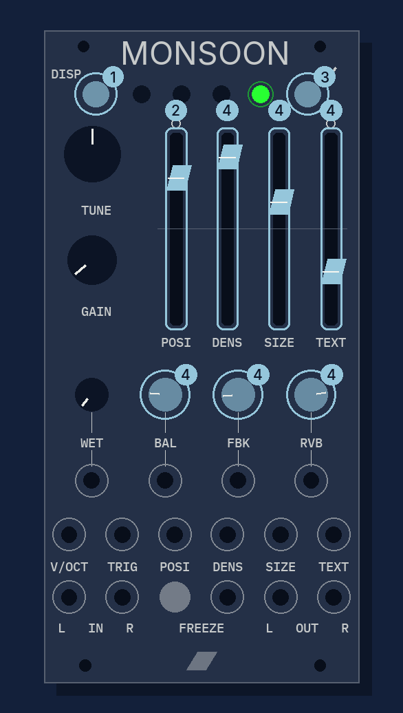


1. Hold **DISP**. The four top LEDs show a number.
2. Push **POSITION** up or down to pick a mode. **Tap WRITE** to flip
   between the green bank and the red bank.
3. Let go of **DISP**.
4. Play something in, and wiggle all four sliders, then the three small
   knobs **BAL**, **FBK** and **RVB**. They're the mode's own extra controls:
   BAL at noon and FBK/RVB at zero is the mode plain. **FREEZE** and **TRIG**
   do something different (and good) in every mode too.

The rest of this manual is the long-range forecast.

---

## 1. Installing (getting the cloud up there)

You get:

| File | What for |
|---|---|
| `cirrostratus.wav` | update through the audio input, no tools |
| `cirrostratus.bin` | the application, for SWD |
| `cirrostratus_bootloader_combo.bin` | bootloader + application, for a blank chip |

### 1a. By ear (recommended)

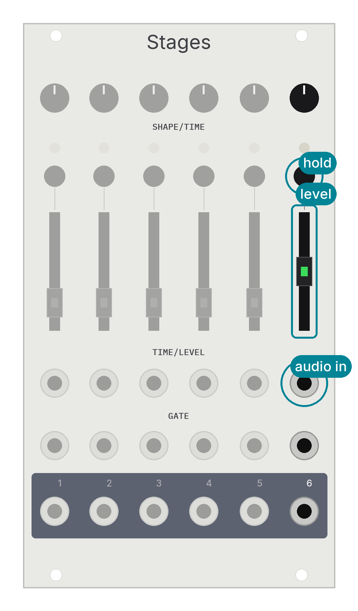


Your Monsoon already has the Clouds/Monsoon audio bootloader if it runs any
of the "build_4" Monsoon firmwares.

1. Rack **off**.
2. Cable from your computer's headphone/line out into **IN L**. No Bluetooth,
   no system sounds, close the chat apps.
3. **Hold FREEZE** and switch the rack on. The FREEZE LED blinks: the module
   is listening for weather data.
4. Computer volume about ¾, **GAIN** about noon.
5. Play `cirrostratus.wav` from the beginning (about 6¼ minutes; put the kettle on). It sounds like a
   modem singing. That's correct.
    - While it receives, the LEDs dance with the level.
    - **All four light green** each time a chunk is written to flash.
    - When the file ends, the module reboots into Cirrostratus and greets you
     with a little **rain** running across the LEDs.
6. **Four red blinking LEDs** mean reception failed (too quiet, too loud, a
   notification ping…). Press **FREEZE**, fix the level, and play the file
   again from the start. Nothing can break: the bootloader is never
   overwritten.

### 1b. With a programmer (SWD)

1. `brew install open-ocd`
2. Connect an ST-Link to the 10-pin SWD header on the Monsoon board, with
   the module powered.
3. In the firmware folder:
    - `make -f monsoon/makefile flash` writes the application and keeps the
     bootloader, settings and slots.
    - `make -f monsoon/bootloader/makefile && make -f monsoon/makefile flash_all`
     writes bootloader + application to a blank chip (settings reset).

### After landing

- Your **V/OCT calibration comes along** from the stock firmware
  automatically. Never calibrated? See 3.9.
- **Coming from an earlier Cirrostratus?** Settings, per-mode options,
  envelope routings and save slots carry over untouched. Mono bass
  starts on; buffer quality starts at 48 kHz 16-bit (exactly as before).
  If the module was in GRAINS it starts in SPECTRAL, and slots saved from
  GRAINS are skipped.
- Old Clouds save slots aren't compatible. Cirrostratus recognises and
  ignores them; it never plays garbage.
- **Back to stock:** flash the stock Monsoon firmware the same way. Clouds
  never mind.

---

## 2. The panel

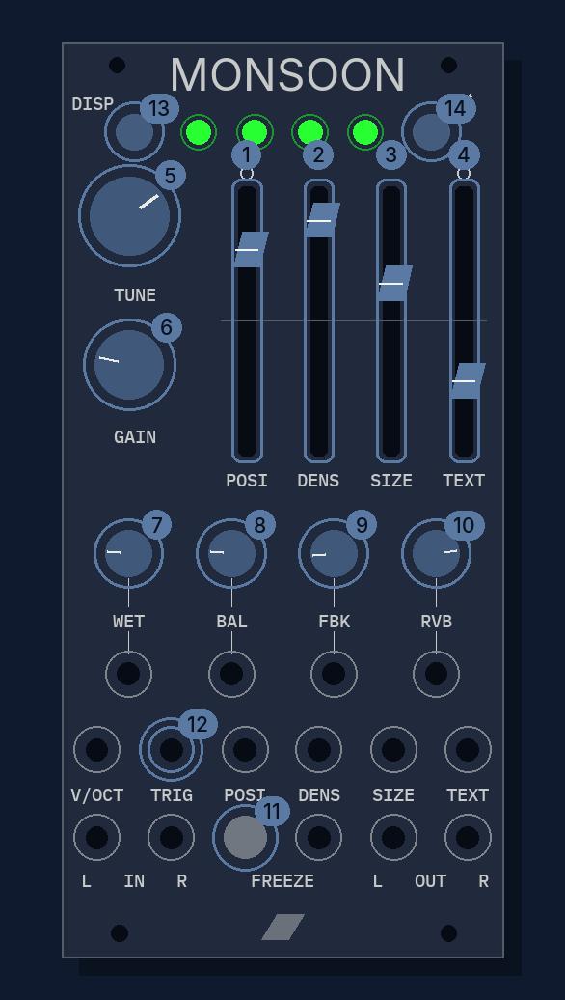

| On the panel | We call it | |
|---|---|---|
| ① slider + CV | **POSITION** | also picks the mode in the mode menu |
| ② slider + CV | **DENSITY** | |
| ③ slider + CV | **SIZE** | |
| ④ slider + CV | **TEXTURE** | |
| ⑤ TUNE knob + V/OCT | **PITCH** | ±4 octaves; it gently snaps to semitones; noon = no change |
| ⑥ GAIN | input gain | analog, as before |
| ⑦ WET + CV | **WET** | dry ↔ wet, equal power, on every mode |
| ⑧ BAL + CV | **BAL** | the mode's own control: bipolar, plain at noon |
| ⑨ FBK + CV | **FBK** | the mode's own control: plain at zero |
| ⑩ RVB + CV | **RVB** | the mode's own control: plain at zero |
| ⑪ FREEZE + gate | **FREEZE** | the gate flips whatever the button says |
| ⑫ TRIG in | **TRIG** | a different job in every mode |
| ⑬ DISP | **DISP** | display, mode menu |
| ⑭ ✎ | **WRITE** | load, save, bank flip |

The slider LEDs still show incoming CV (that's hardware). The four LEDs
along the top belong to Cirrostratus.

**BAL, FBK and RVB are per-mode controls.** Each mode's table in section 5
says what they do. The house rule: **BAL is bipolar** (noon = the mode
plain, left and right of noon do two related things), **FBK and RVB start
at zero** (fully left = the mode plain). Their CV jacks work like the
sliders' (the jack adds to the knob). The names are a loose theme: FBK is
usually something that recirculates or intensifies, RVB something about
space, tail or wash, BAL a balance between two things.

---

## 3. Buttons, pages and little rituals

### 3.0 Sunrise

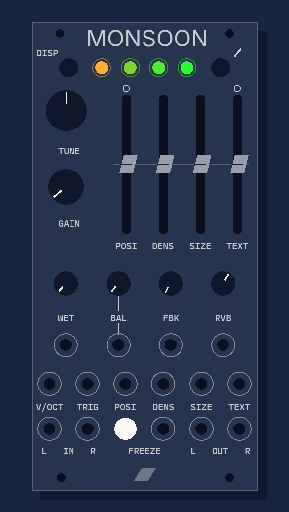

Every time you power up, the module greets you with three seconds of
weather:

1. **Ice crystals**: dim sparkles twinkle across the four LEDs.
2. **Halo**: two amber rings pulse outward from the middle LEDs to the
   edges, and the FREEZE LED glows with each pulse.
3. **The sun breaks through**: amber sweeps to green, left to right.
4. **The forecast**: your current mode in binary (green or red bank),
   fading out.

Any button skips it (that press does nothing else).

### 3.1 Looking at the sky

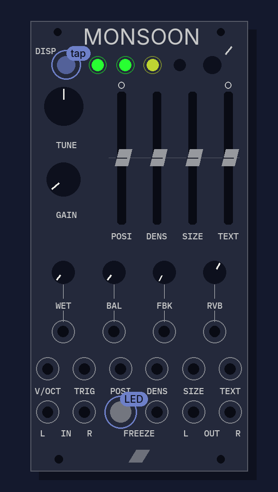

- **Tap DISP**: the LEDs flip between the **input level** meter and the
  values of **WET / BAL / FBK / RVB**. While frozen, the meter shows the
  output.
- The FREEZE LED is the freeze state, always.

### 3.2 Choosing a mode

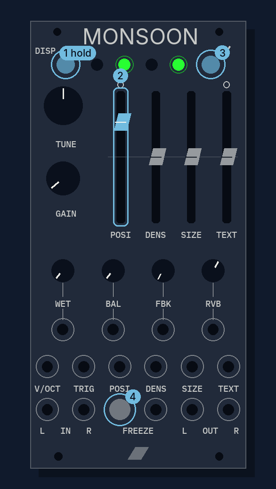

1. **Hold DISP** for a second. The LEDs show the current mode in binary:
   **green = bank 1** (modes 2–15), **red = bank 2** (16–30). Mode 1
   (GRAINS) was retired in 1.5; the others kept their numbers, so bank 1
   has 14 and the bottom of POSITION lands on 2.
2. **Move POSITION** to browse. The menu only starts following POSITION
   once you actually move it, so peeking never changes anything. The sound
   keeps its old POSITION while you browse.
3. **Tap WRITE** to flip banks.
4. **Tap FREEZE** to step through the mode's **options**. Each shows briefly
   as a single LED: green 1–4 for options 1–4, red 1–4 for options 5–8.
5. **Release DISP**. The old mode fades out and the new one fades in
   (about 20 ms, no clicks).

Reading the binary, left to right is 8 · 4 · 2 · 1:

| ●=on | # | | # | | # |
|---|---|---|---|---|---|
| ○○○● | (1) | ○●○● | 5 | ●○○● | 9 |
| ○○●○ | 2 | ○●●○ | 6 | ●○●○ | 10 |
| ○○●● | 3 | ○●●● | 7 | ●○●● | 11 |
| ○●○○ | 4 | ●○○○ | 8 | ●●○○ | 12 |
| ●●○● | 13 | ●●●○ | 14 | ●●●● | 15 |

Red bank: add 15 (red ○○○● is mode 16, red ●●●● is mode 30).

Every mode remembers its own option and envelope routing, even through
power cycles.

### 3.3 Four jars of sky (save slots)

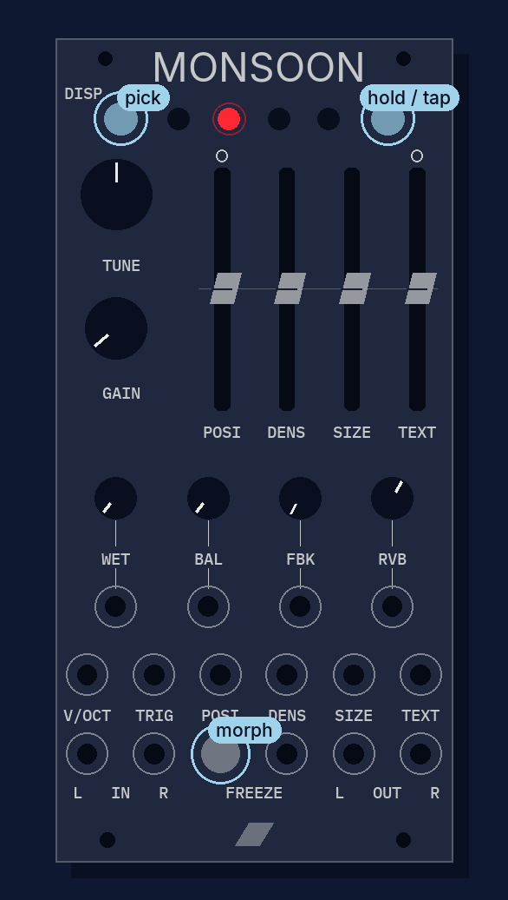

- **Hold WRITE**: the save page (slot LED blinks red). **DISP** picks a
  slot, **WRITE** saves. About a second of silence while flash is written.
- **Tap WRITE**: the load page (slot LED blinks green). **DISP** picks,
  **WRITE** loads. The slot remembers its mode and option, so loading takes
  you there.
- What goes in the jar depends on the mode: a recorded buffer, a frozen
  spectrum, a wavetable, a captured impulse response, a tape loop… Each
  mode below says what it keeps. A jar also keeps the buffer quality (3.7)
  and FFT size (3.8) it was made with, and plays back at them.

**Slot morph** (SPECTRAL and CAPTURE): on the load page, tap **FREEZE**
instead of WRITE. That slot becomes the *morph source*: its LED stays red,
it's read straight from flash, and POSITION blends toward it. Tap FREEZE on
it again to let it go.

### 3.4 The envelope page (weather that follows you)

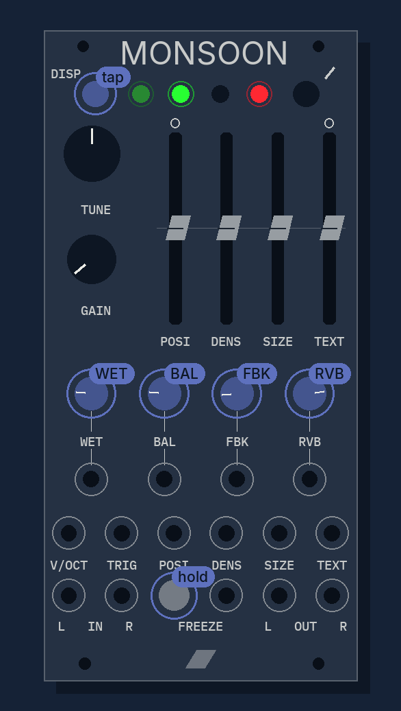

Your input's loudness can push WET and the mode's three knobs up or down:
the wet that opens on loud notes, a BAL that leans further the harder you
play, an FBK that swells in the gaps, an RVB that ducks while you play.
Whatever BAL, FBK and RVB mean in the current mode, that's what moves.

- **Hold FREEZE, tap DISP**: LEDs = WET · BAL · FBK · RVB.
- **DISP** moves the cursor (blinking).
- **FREEZE** cycles its amount: off → +½ (dim green) → +1 (green) →
  −½ (dim red) → −1 (red) → off.
- **WRITE** saves and leaves (it also leaves by itself after 6 s).
- Each mode keeps its own routing. Routings made with 1.0 carry over to the
  same knobs.

### 3.5 FREEZE and TRIG
- FREEZE toggles on **release**, because the button is also a modifier.
- The FREEZE **gate** inverts the button: button off + gate high = frozen;
  button on + gate high = thawed.

### 3.6 Mono bass on/off

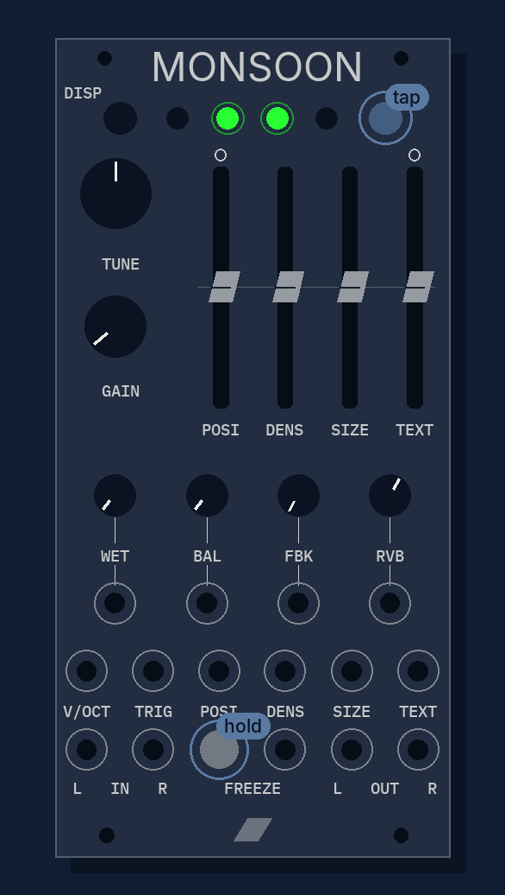

**Hold FREEZE, tap WRITE.** For 1.5 s the LEDs tell you the new state:

- the **two middle LEDs green**: bass gathered in the middle (mono bass
  **on**, the default);
- the **two outer LEDs amber**: bass out at the sides (mono bass **off**,
  full stereo all the way down).

The setting is remembered through power cycles. FREEZE doesn't toggle
freeze when you use it for this.

### 3.7 Buffer quality (longer buffers)

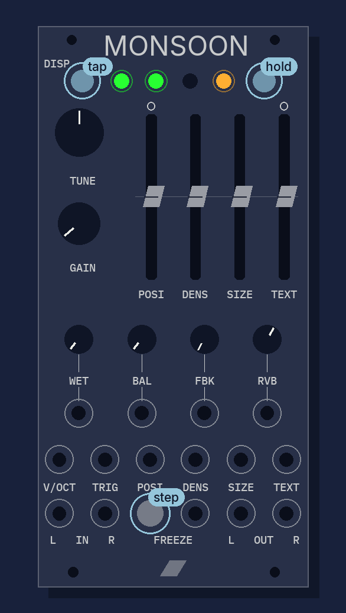

One master setting for every mode that records into a buffer: **STRETCH,
CAPTURE, TAPE, BARBERPOLE** and **BLOOM**. Store the audio at a
lower sample rate and/or 8-bit and the same memory holds up to six times
as much sound.

**Hold WRITE, tap DISP** (it doesn't matter how long you've held WRITE).
An amber light sweeps across the four LEDs: you're on the page, and LED 4
stays amber while you are. **FREEZE** steps through the six settings, LEDs
1–3 show the one you're on:

| LEDs | Setting | Length | Sound |
|---|---|---|---|
| ● green | 48 kHz 16-bit | 1× | full quality (the default, exactly 1.0/1.1) |
| ●● green | 24 kHz 16-bit | 2× | top end stops at ~9.6 kHz |
| ●●● green | 16 kHz 16-bit | 3× | top end stops at ~6.4 kHz: warm, dusty |
| ● red | 48 kHz 8-bit | 2× | full range, a fine grain of noise under loud parts |
| ●● red | 24 kHz 8-bit | 4× | both |
| ●●● red | 16 kHz 8-bit | 6× | both: lo-fi, longest |

LED 4 blinks amber while the choice differs from the current one. **WRITE**
applies it: all four LEDs flash its colour, then the page closes. **DISP**
(or 6 s) leaves without changing anything.
Applying restarts the running mode's buffer empty, so do it before you
record. Modes without a buffer don't notice.

How long that makes each buffer (seconds):

| Mode | 48k 16 | 24k 16 | 16k 16 | 48k 8 | 24k 8 | 16k 8 |
|---|---|---|---|---|---|---|
| STRETCH stereo | 0.30 | 0.60 | 0.90 | 0.59 | 1.18 | 1.76 |
| STRETCH mono | 0.89 | 1.77 | 2.66 | 1.75 | 3.49 | 5.23 |
| CAPTURE (capture length) | 0.50 | 1.01 | 1.51 | 0.99 | 1.99 | 2.98 |
| TAPE stereo (head 3 at 1× speed) | 0.60 | 1.19 | 1.79 | 1.19 | 2.37 | 3.56 |
| TAPE mono (head 3 at 1× speed) | 1.20 | 2.41 | 3.61 | 2.38 | 4.76 | 7.15 |
| BARBERPOLE (longest loop) | 0.50 | 1.00 | 1.50 | 1.00 | 2.00 | 3.00 |
| BLOOM (longest window; delay is 2×) | 0.28 | 0.56 | 0.84 | 0.56 | 1.12 | 1.68 |

The lower rates use a steep anti-alias filter (8th-order elliptic, 80 dB
down), so nothing folds back. TAPE's rate setting simply runs the tape 2× or
3× slower, which is what a real one would do. A **save slot remembers the
quality it was recorded with** and plays back at it, whatever the setting;
the next time the mode restarts it follows the setting again.

### 3.8 FFT size (spectral resolution)

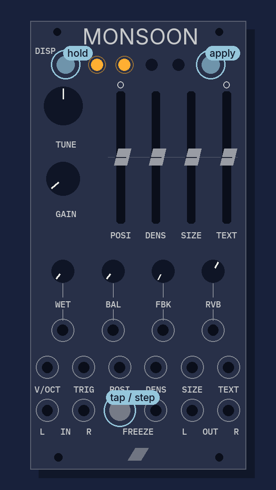

One master setting for the modes that work in the frequency domain:
**SPECTRAL** (and its SMEAR option), **CROSS, STRETCH, PUTZ, QUELL,
SPECDELAY** and **MIRROR**. Each has its own FFT size, the one it has
always had; this page lets you run them all at one size instead.

**Hold DISP, tap FREEZE**: a green light sweeps back across the LEDs and
the page is open. **FREEZE** steps through the settings, the LEDs show the
size as a bar:

| LEDs | Setting | Window | Sound |
|---|---|---|---|
| green bar | each mode's own | (shows the running mode's) | as always (the default) |
| ● amber | 256 | 5 ms | sharp in time, coarse in pitch: transients stay crisp, partials blur into bands, smears turn grainy and robotic |
| ●● amber | 512 | 11 ms | |
| ●●● amber | 1024 | 21 ms | |
| ●●●● amber | 2048 | 43 ms | fine in pitch, soft in time: single partials, smooth glassy freezes, attacks wash out |

The bar blinks while the choice differs from the current one. **WRITE**
applies it (all four LEDs flash), **DISP** (or 6 s) leaves without
changing anything. Applying restarts the running spectral mode (a frozen
spectrum is cleared); other modes don't notice. Every time constant (blur,
envelope followers, decays, delay times) is converted, so a knob does the
same thing at every size, only the resolution changes.

Own sizes: SPECTRAL, CROSS, STRETCH 2048; PUTZ, QUELL, MIRROR 1024;
SPECDELAY and SMEAR 512. PUTZ and SPECDELAY go up to 1024 (at 2048 they
don't fit in memory next to the rest of the mode) and stay there if you
pick 2048. At 256 the lowest bin is 187 Hz wide, so the very bottom
(below ~90 Hz) thins out in the resynthesising modes.

A **save slot remembers the FFT size** it was saved with (a frozen
spectrum only fits its own size) and plays back at it; the next time the
mode restarts it follows the setting again. The CPU cost is about the same
at every size (measured: within 5 % of each mode's own).

### 3.9 Teaching it volts (V/OCT calibration)

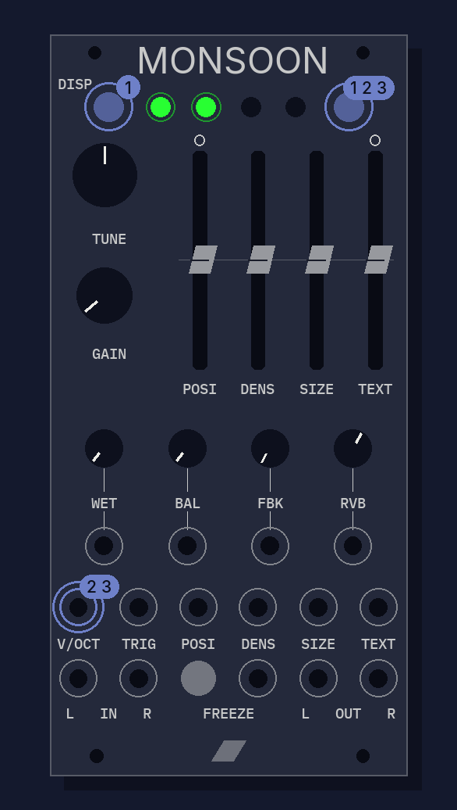

1. **Hold DISP** (the menu opens), then also **hold WRITE** for a second.
   Two LEDs blink.
2. Send **1 V** into V/OCT, tap **WRITE**. Four LEDs blink.
3. Send **3 V**, tap **WRITE**. Done. Red means the readings looked wrong:
   check the voltages and try again.

---

## 4. The output section, on every mode

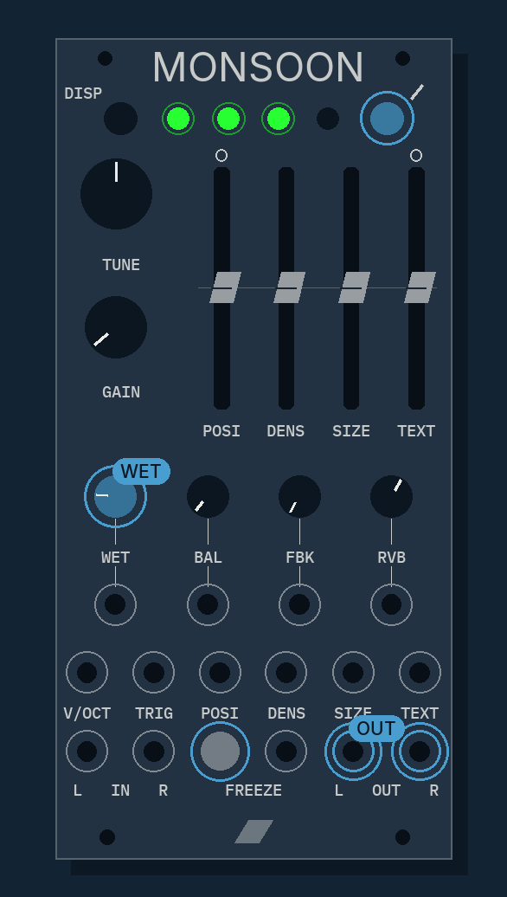


```
IN ─┬──────────────────────────────────────────┐ dry
    │                                          │
    └─► MODE ─► DC block ─► WET ─┬─(+ reverb)─(+)─► MONO BASS ─► LIMITER ─► OUT
         ▲                       │   if the mode     < 60 Hz
         └── feedback loop ◄─────┘   uses it
             if the mode uses it
```

- **WET**: equal power, dry ↔ wet. With mono bass switched off, fully dry
  is bit-transparent.
- **Hard stereo.** No widener any more: left is left, right is right,
  exactly what the mode makes. Modes that are naturally wide (LEITNER,
  ENSEMBLE, HALL…) are wide on their own.
- **MONO BASS** (on by default): below 60 Hz the whole main out (dry and wet) is
  summed to mono, L+R halved to both sides; above it nothing changes. It's
  a 4th-order Linkwitz-Riley crossover, so the two halves add back up to a
  flat response. Your sub stays in the middle of the club, your vinyl cut
  stays cuttable. **Hold FREEZE, tap WRITE** to switch it (3.6).
- **LIMITER**: −1 dBFS peak limiter, transparent below −2 dBFS, then TPDF
  dither into the codec.

**What happened to FEEDBACK and REVERB?** They became engine services that
a mode can borrow for one of its knobs when that's truly the best control
for it. CONVOLVE and BLOOM borrow the feedback loop for FBK (the classic
Clouds feedback, with its built-in howl tamer: two adaptive notches that
talk down a whistling loop). The dry voices and mono modes that have no space
of their own borrow the reverb (the 8-line FDN, 0.5 → 16 s) for RVB: DIFFERENCE, CROSS, CAPTURE, GENDY,
PLATES, FALTUNG, LEITNER, TANTRI, ENSEMBLE, CHOIR, FOLDER, GAMELAN and
MIRROR. Everything else (72 of the 87 knob jobs) is the mode's own, and a
mode pays no CPU for a reverb it doesn't use.

---

## 5. Modes

**PITCH** = TUNE knob + V/OCT. WET always blends dry and wet. **BAL**,
**FBK** and **RVB** are each mode's own: BAL at noon and FBK/RVB at zero
give the mode plain, exactly as in 1.0. "Keeps" = what a save slot holds
for that mode.

### Bank 1 (green) · 2–15 (mode 1, GRAINS, retired in 1.5)

#### 2 · SPECTRAL — spectral freeze / resynthesis
*Forecast: a held moment, refracted into its colours.*

2048-point phase vocoder with peak-locked partials (64 ms latency; 256–2048 with the FFT size setting, 3.8).

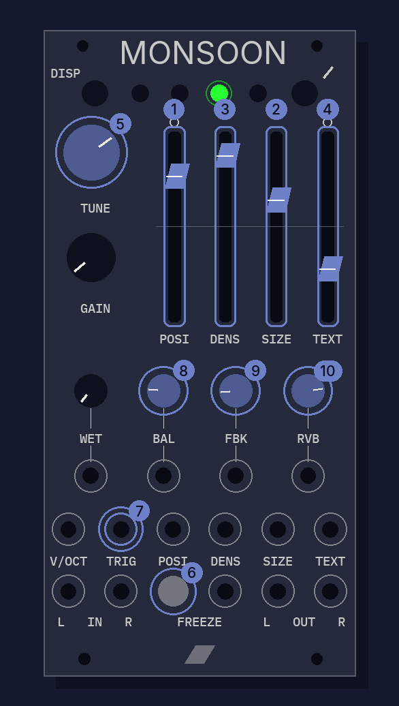

| Control | |
|---|---|
| ① POSITION | partial thinning: all bins → only the strongest peaks. With a morph slot armed: blend from the current spectrum to the slot's |
| ② SIZE | harmonic snap: pulls partials onto the harmonic series of the PITCH root |
| ③ DENSITY | blur (smears the spectrum over time) |
| ④ TEXTURE | tilt, dark ↔ bright, flat at noon (±9 dB/oct) |
| ⑤ PITCH | transposition without changing speed |
| ⑥ FREEZE | hold the spectrum; it keeps resynthesising with a slight drift |
| ⑦ TRIG | grab a new spectrum while frozen |
| ⑧ BAL | noon = as before. Turning it shifts every partial by the same number of Hz (not a ratio), so harmonic sounds go inharmonic. Left shifts down, right shifts up, exponential: a few Hz near noon, ±1 kHz at the ends |
| ⑨ FBK | regeneration: the last output spectrum comes back as a floor under the next frame (held 0.1 → 8 s). On its own it sustains; with BAL or PITCH set every pass moves the partials again, so they spiral up or down |
| ⑩ RVB | phase diffusion: random phases blend in, coherent → a whispered wash in the same colours |
| ⑪ Options | 1 as above · 2 SMEAR (below) |
| ⑫ Keeps / morph | the frozen spectrum / yes (option 1) |

**Option 2 · SMEAR** — *a photograph left out in the rain.* The spectral
smear from Sleepcousonique's Wingie mode, the same sound: the spectrum is
blurred in time and a little across frequency, and its partials carry on.
512-point transform (256–2048 with the FFT size setting, 3.8), 4× overlap,
16 ms latency. Mono, like the Wingie's: the
mid (L+R) is smeared and comes out of both sides.


| Control | |
|---|---|
| ① DENSITY | blur: none (the sound as it is) → seconds; long blurs beat and shimmer |
| ② FREEZE | hold: the blur stops where it is |
| ③ RVB | reverb (the module's FDN reverb: SMEAR's space) |
| Keeps / morph | nothing / no |

#### 3 · CONVOLVE — freeze captures the impulse response
*Forecast: the room you're standing in is whatever you just played.*

Your own audio becomes the space the sound plays in. The impulse response
(IR) can be up to 139 ms, and FBK makes it ring on much longer. The
mode starts with a small synthetic room so it sounds straight away.

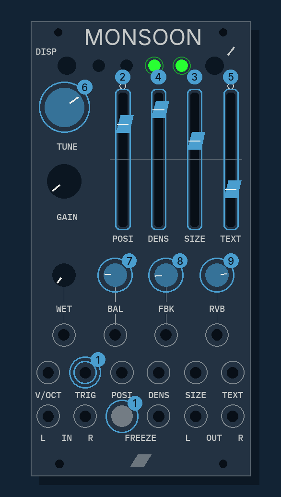

| Control | |
|---|---|
| ① FREEZE (on) / TRIG | capture a new IR from the last 139 ms of input |
| ② POSITION | where in that capture the IR starts (bottom = newest) |
| ③ SIZE | IR length, with fade-out |
| ④ DENSITY | IR envelope: reverse swell ← as captured (noon) → faster decay |
| ⑤ TEXTURE | IR brightness: low-pass below noon, treble boost above |
| ⑥ PITCH | IR playback rate |
| ⑦ BAL | noon = as before. Left: only the attacks of the input reach the IR. Right: only the body (attacks ducked, so hits swell instead of crack). It shapes the input before everything, so captures hear it too |
| ⑧ FBK | feedback (the module's feedback loop, with its howl tamer): the IR rings on much longer |
| ⑨ RVB | IR smear: the IR gets eight decaying echoes of itself (3 → 97 ms), and captures melt into a dense wash |
| Keeps | the capture and its settings |

#### 4 · RESONATOR — sympathetic strings with jawari
*Forecast: eight strings hum along, with a buzzing bridge.*

Eight tuned strings, excited by the input, tuned to the cent.

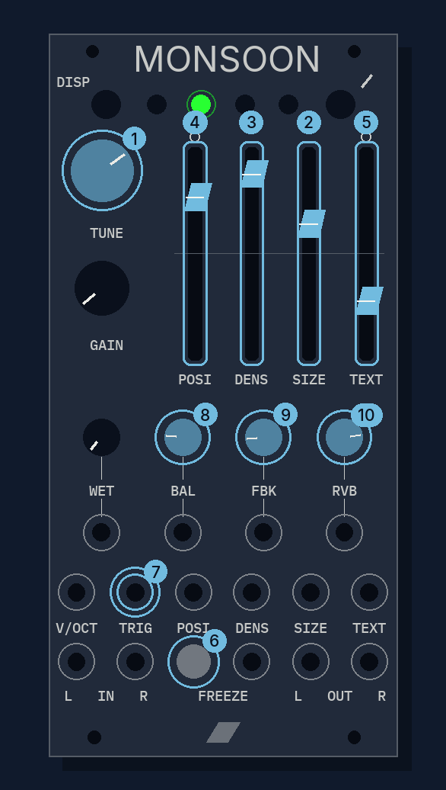

| Control | |
|---|---|
| ① PITCH | root (C2 at noon), V/OCT |
| ② SIZE | tuning: unison/octaves → fifths → sitar sympathetic set → harmonic series → inharmonic |
| ③ DENSITY | decay 0.2 → 20 s |
| ④ POSITION | brightness and pickup point |
| ⑤ TEXTURE | jawari: clean string → strong sitar-bridge buzz |
| ⑥ FREEZE | infinite sustain, input cut |
| ⑦ TRIG | pluck all strings |
| ⑧ BAL | noon = as before. Left: detune, the strings spread up to ±25 cents (beating, a chorus of strings). Right: stretch, intervals widen up to +10 % (an octave ~+120 cents: piano-like, then bell-like) |
| ⑨ FBK | sympathetic coupling: energy passes from string to string. Strings tuned close together trade it back and forth (slow beating, blooming), and a note in one wakes the others |
| ⑩ RVB | body: the strings sound through a resonant wooden box (~8.5 ms resonance, tail up to ~0.35 s) |

#### 5 · DIFFERENCE — difference tones (after the Oneirophone)
*Forecast: notes that only happen inside your head. Really.*

The input is frequency-shifted into high pairs of tones, f and f + Δ. Your
ear makes the tone at Δ, a note that isn't in the signal.

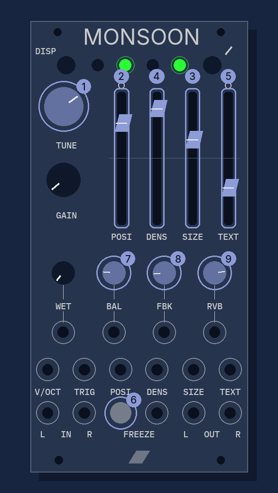

| Control | |
|---|---|
| ① PITCH | the heard tone Δ (C3 at noon), V/OCT |
| ② POSITION | register of the pairs, 2 → 8 kHz |
| ③ SIZE | input bandwidth: narrow (purest illusion) → whole input (rich) |
| ④ DENSITY | 1 → 6 pairs: Δ × 1, 3/2, 5/4, 2, 7/4, 9/8 (a chord of phantom notes) |
| ⑤ TEXTURE | purity: 0 = only in your ear; up = the difference tone becomes physically present (works through any speaker) |
| ⑥ FREEZE | drone of pure sine pairs at the held level |
| ⑦ BAL | noon = as before. Left: glide, the heard note slides to each new pitch (20 ms → 2 s). Right: dichotic, f to the left ear and f + Δ to the right; on headphones the difference tone gives way to binaural beats |
| ⑧ FBK | spiral: the shifted sound recirculates (50 ms) and climbs by Δ on every pass. Echoes rise; held sounds build a ladder f, f+Δ, f+2Δ… that makes the phantom note stronger |
| ⑨ RVB | reverb (the module's FDN reverb; both tones reverberate, so the phantom note survives) |

#### 6 · CROSS — left/right spectral morph
*Forecast: two weather fronts collide.*

Left input = modulator, right input = carrier (64 ms latency). With only IN L patched,
both sides are the same signal. FFT 2048 (256–2048 with the FFT size
setting, 3.8).

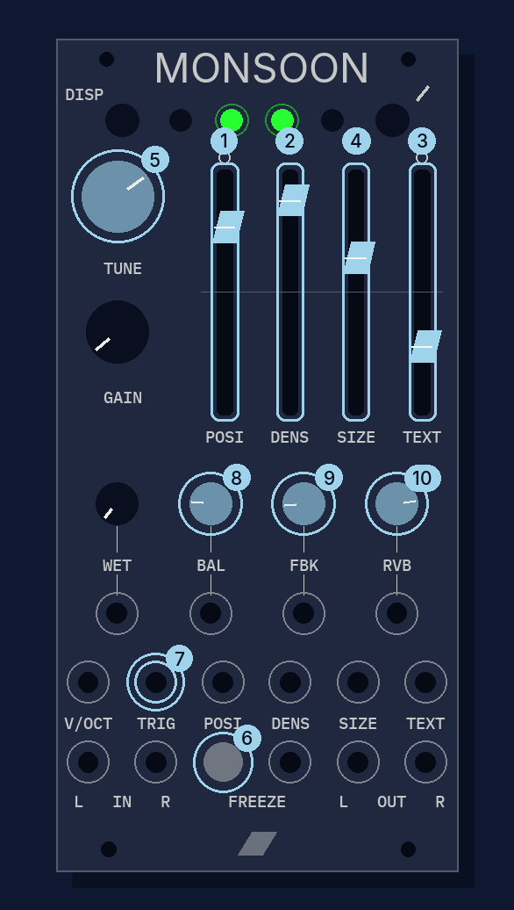

| Control | |
|---|---|
| ① POSITION | vocoder (L's envelope on R) → morph → L's magnitudes with R's phases |
| ② DENSITY | envelope resolution (coarse vocoder bands → fine detail) |
| ③ TEXTURE | envelope speed (attack/release) |
| ④ SIZE | formant shift of the modulator (×0.5 → ×2) |
| ⑤ PITCH | carrier transposition |
| ⑥ FREEZE | hold the modulator |
| ⑦ TRIG | toggle holding the carrier |
| ⑧ BAL | noon = as before (carrier = right input). Left: the carrier fades to white noise (whispered; consonants come through). Right: it fades to an internal buzz played by PITCH (C3 at noon, V/OCT), a classic vocoder from one input; PITCH then stops transposing R |
| ⑨ FBK | formant emphasis: the modulator's envelope sharpens (peak and energy kept): more talkative, then resonant, wah-like peaks |
| ⑩ RVB | reverb (the module's FDN reverb; CROSS is mono, this gives it a stereo room) |

#### 7 · STRETCH — extreme time-stretch
*Forecast: one second, smeared across an afternoon.*

A phase vocoder with phase locking reads a recorded buffer slowly: 0.30 s
stereo or 0.89 s mono, up to 1.76 s / 5.23 s at a lower buffer quality (3.7).
FFT 2048 (256–2048 with the FFT size setting, 3.8: smaller is more
transient, less smooth).

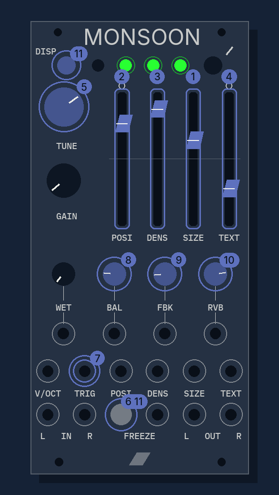

| Control | |
|---|---|
| ① SIZE | stretch: 1× → ~1000× at 0.9 → standing still from about 0.98 |
| ② POSITION | where the read zone sits in the buffer |
| ③ DENSITY | smear |
| ④ TEXTURE | coherent (phase vocoder) → Paulstretch (random phases) |
| ⑤ PITCH | transposition without speed change |
| ⑥ FREEZE | stop recording |
| ⑦ TRIG | jump to the newest audio |
| ⑧ BAL | noon = as before. Left: the read slows, stands still at 9 o'clock, and runs backwards at full left. Right: scatter, the read window jumps to random spots (up to half the buffer away, ~10 jumps/s) |
| ⑨ FBK | re-record: the output goes back into the recording, so stretches get stretched again and smear into drones (nothing is recorded while frozen) |
| ⑩ RVB | octave halo: every partial also sounds an octave up, a shimmer over the stretch |
| ⑪ Options | 1 stereo · 2 mono (longer) |
| Keeps | the buffer |

#### 8 · SPREEK — voice
*Forecast: everything starts talking (and singing).*

LPC speech analysis, five-formant vowels and a singing carrier. BAL, FBK
and RVB shape the internal carrier, so they need DENSITY above zero.

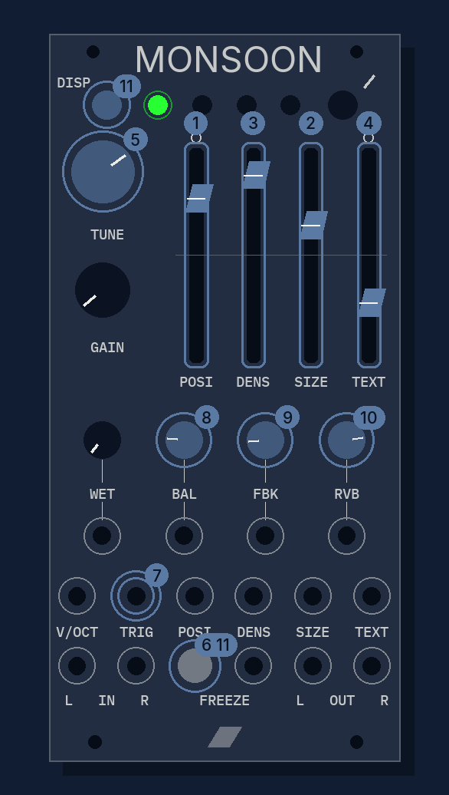

| Control | |
|---|---|
| ① POSITION | bottom: the input's own voice envelope (talkbox); then vowels a → e → i → o → u |
| ② SIZE | vocal-tract length (formants × 0.7 → 1.4) |
| ③ DENSITY | source: the input itself → an internal singing carrier at PITCH, following the input's level |
| ④ TEXTURE | smooth → breathy |
| ⑤ PITCH | carrier pitch, V/OCT |
| ⑥ FREEZE | hold the phoneme as a drone |
| ⑦ TRIG | consonant burst |
| ⑧ BAL | noon = as before. Left: glide (PITCH slides; an octave takes up to ~0.6 s). Right: vibrato (5.3 Hz, up to ±1 semitone) |
| ⑨ FBK | growl: every other glottal period comes weaker and longer — from a rough edge to vocal fry with an undertone an octave down (pitch stays put) |
| ⑩ RVB | choir: two more carriers join, up to ±22 cents apart and drifting, so one voice becomes a small chorus |
| ⑪ Options | 1 adult formants · 2 child formants |

#### 9 · CAPTURE — captured wavetable voice
*Forecast: catch a sound, play it like a synth.*

FREEZE turns the last half second of input (up to 3 s at a lower buffer
quality, 3.7) into a 16-frame wavetable. The
table is band-limited per octave, so it stays alias-free up high. Until the
first capture it plays a sine → saw table.

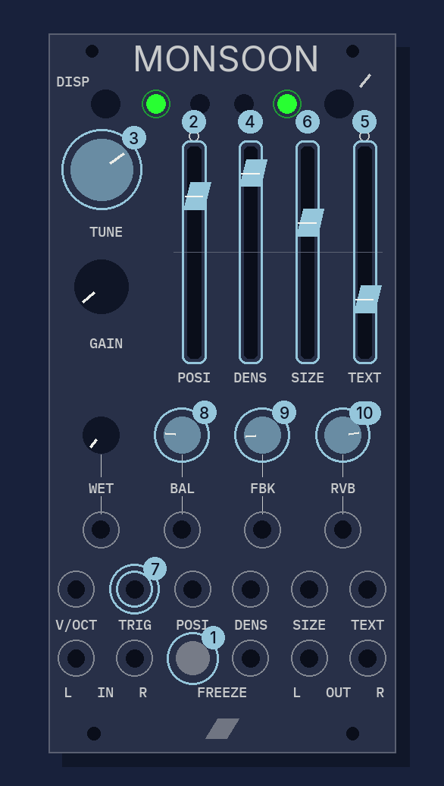

| Control | |
|---|---|
| ① FREEZE | capture (pitch-detected, one period per frame) |
| ② POSITION | scan through the frames (and on into the morph slot's frames) |
| ③ PITCH | V/OCT, C3 at noon |
| ④ DENSITY | unison 1 → 7 voices, detuned and spread |
| ⑤ TEXTURE | brightness |
| ⑥ SIZE | envelope: pluck → pad |
| ⑦ TRIG | gate. Drones until the first gate arrives |
| ⑧ BAL | noon = as before. Left: bend — phase distortion, the first half of each cycle read up to 6× faster (CZ style). Right: sync formant — the table read up to 6× per cycle under a soft window, a resonant peak sweeping up. Stays alias-free |
| ⑨ FBK | self-FM: each voice bends its own phase (DX-style operator feedback) — warmer, then saw-like, then a rasp |
| ⑩ RVB | reverb (the module's reverb, for a voice with no space of its own) |
| Keeps / morph | the table / yes |

#### 10 · GENDY — dynamic stochastic synthesis (Xenakis)
*Forecast: Brownian drizzle, organised by Xenakis.*

Two independent GENDYN voices (left/right). The breakpoints of a waveform
take bounded random walks.

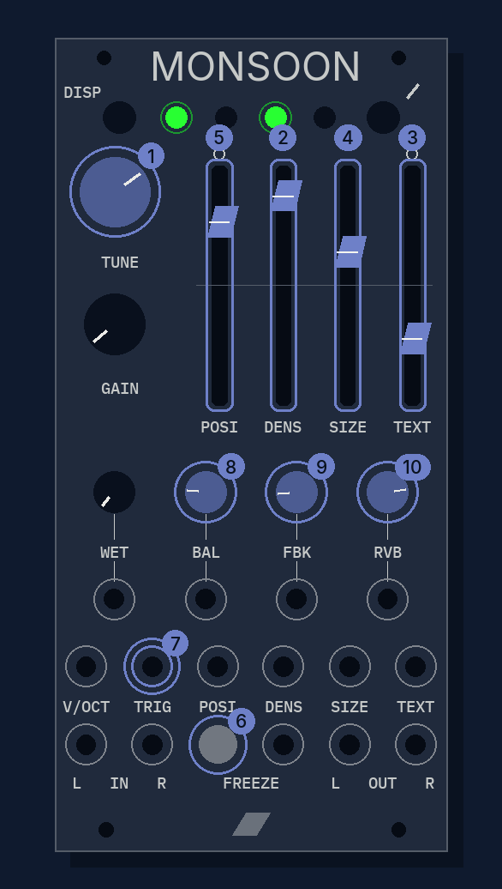

| Control | |
|---|---|
| ① PITCH | centre frequency, V/OCT |
| ② DENSITY | 3 → 40 breakpoints |
| ③ TEXTURE | step size: static → restless |
| ④ SIZE | barriers: stable pitch → wild |
| ⑤ POSITION | random distribution: Cauchy → logistic → hyperbolic cosine → arcsine |
| ⑥ FREEZE | freeze the walks (the waveform repeats exactly) |
| ⑦ TRIG | reseed the breakpoints from the input's last period |
| ⑧ BAL | noon = both voices around PITCH. The right voice moves in whole semitones: left down to an octave below, right up to an octave above (fifths, fourths, octaves) |
| ⑨ FBK | cross-coupling: each voice stretches or squeezes the other's segments (up to ±80 %), so the two walks start steering each other |
| ⑩ RVB | reverb (the module's reverb) |
| Keeps | the breakpoints |

#### 11 · SHIMMER — shimmer cascade
*Forecast: a reverb whose echoes keep climbing toward the sun.*

A diffuse four-line delay network with pitch shifters inside, so every pass
climbs (or falls) again.

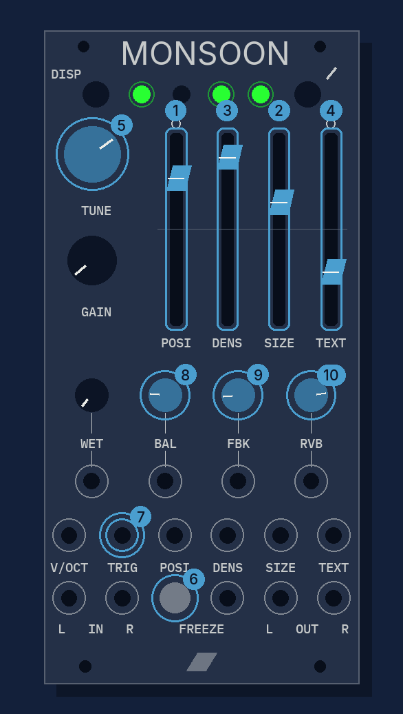

| Control | |
|---|---|
| ① POSITION | harmonic set: plain · octave · fifth · octave + fifth · Oneirophone ratios (7/4, 9/8, 3/2) · octave down |
| ② SIZE | room size |
| ③ DENSITY | decay, up to endless |
| ④ TEXTURE | damping |
| ⑤ PITCH | extra transposition of the shift |
| ⑥ FREEZE | hold forever, input muted |
| ⑦ TRIG | clear the tail |
| ⑧ BAL | noon = as before. Left: less of each pass is shifted (fully left = a plain reverb in any set). Right: mirror — the fourth line falls by the inverse of the set's interval, so the cascade climbs and falls |
| ⑨ FBK | tank modulation: the four delay lines wobble on two slow LFOs; the ringing smears into a lush, chorused tail |
| ⑩ RVB | pre-delay 0 → 250 ms before the network (glides when turned) |

#### 12 · TAPE — multi-head tape echo
*Forecast: warm, wobbly, three heads at the ready.*

Variable-speed tape with an anti-aliased record path: slower tape gives
longer, darker echoes. Heads at 1×, 2× and 3× spacing (0.2 / 0.4 / 0.6 s at
1× in stereo, about twice that in mono; up to 6× longer at a lower buffer
quality, 3.7).

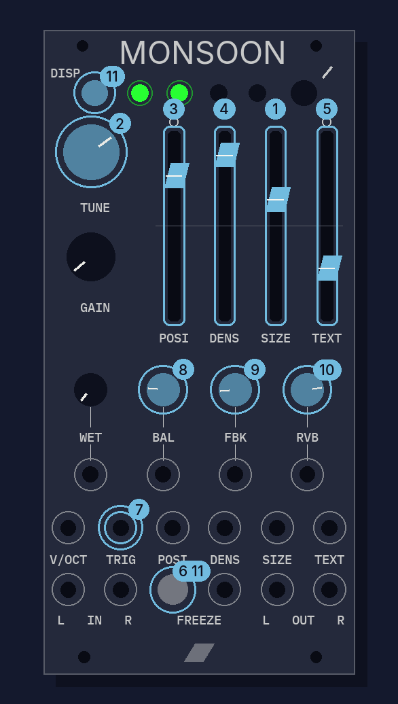

| Control | |
|---|---|
| ① SIZE | tape speed ×0.25 → ×2 (×1 at noon) |
| ② PITCH | fine speed, V/OCT (together with SIZE: ×0.0625 → ×3; the tape stops speeding up at ×3) |
| ③ POSITION | heads: 1 · 2 · 3 · 1+2 · 2+3 · 1+3 · 1+2+3 · all into the repeats · swell |
| ④ DENSITY | feedback, up to gentle self-oscillation |
| ⑤ TEXTURE | tape character: wow, flutter, saturation, head bump |
| ⑥ FREEZE | loop hold: repeats sustain, no new input |
| ⑦ TRIG | tape stop (spins down); next TRIG spins back up |
| ⑧ BAL | noon = as before. Left: darker repeats (loop low-pass 7 kHz → 500 Hz). Right: thinner repeats (loop high-pass up to 2 kHz), the dub telephone fade |
| ⑨ FBK | ping-pong: the repeats cross to the other side (fully right = every repeat swaps). Stereo tape only |
| ⑩ RVB | diffusion in the loop: every pass smears a little more, so the echoes melt into a spring-like wash |
| ⑪ Options | 1 stereo · 2 mono (twice as long) |
| Keeps | the tape |

#### 13 · PLATES — sympathetic plates (after the Ronin plates)
*Forecast: sheet metal (and glass, and wood) singing back.*

24 plate modes from real plate physics, read by two pickups and excited by
the input.

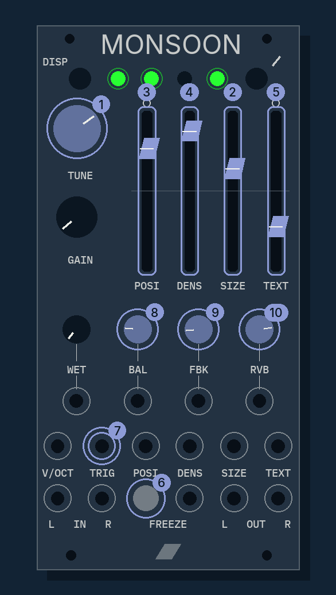

| Control | |
|---|---|
| ① PITCH | root, V/OCT |
| ② SIZE | shape: square plate → long bar |
| ③ POSITION | strike/pickup position |
| ④ DENSITY | decay 0.3 → 30 s |
| ⑤ TEXTURE | material: metal → glass → wood |
| ⑥ FREEZE | ring forever, input cut |
| ⑦ TRIG | strike |
| ⑧ BAL | noon = as before. Left: the modes are pulled onto whole harmonics (fully left = a tuned, pitched plate). Right: the series stretches — more clang, bell / tam-tam |
| ⑨ FBK | tension: hard hits ring sharp (up to ~3 semitones) and glide back down as they decay |
| ⑩ RVB | reverb (the module's reverb, so a struck plate gets a room) |

#### 14 · CHLOE — the Chloaelis strip
*Forecast: your Chloaelis, shrunk to fit the cloud.*

Your Chloaelis channel strip, one per side, hard left and right: multimode
filter → 12AX7 tube → delay. The Lorenz attractor pushes the left and right
cutoffs apart and lets the filter wander between low-pass and band-pass.

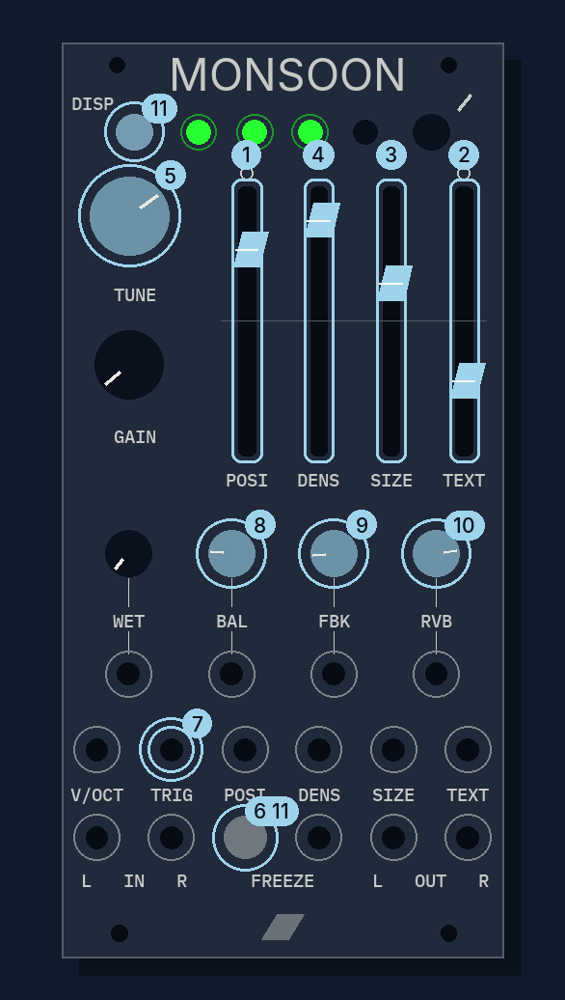

| Control | |
|---|---|
| ① POSITION | filter cutoff 30 Hz → 16 kHz |
| ② TEXTURE | tube drive (bottom = tube out) and filter resonance |
| ③ SIZE | delay time 20 ms → 1.6 s (tape: up to 0.45 s). String engine: interval of the right string (unison, 5th, octave, 12th, 2 octaves, 4th) |
| ④ DENSITY | regeneration; past about 85 % it runs away and sings |
| ⑤ PITCH | transposes the cutoff (play the resonant filter). String engine: the note |
| ⑥ FREEZE | delay freeze: PT2399 RAM held bit for bit, BBD buckets, tape loop, string |
| ⑦ TRIG | random freeze (0.2–1.5 s). String engine: pluck |
| ⑧ BAL | the Lorenz attractor: noon = as before. Left: calmer and shallower until it stops (both cutoffs together, the filter halfway LP/BP, ¼ speed). Right: up to 8× faster and ±3 octaves, the filter wandering LP → BP → HP |
| ⑨ FBK | master feedback, crossed like the plug-in: left out → right in, right out → left in. With regen up it ping-pongs and can sing |
| ⑩ RVB | diffusion in the regen loop: every repeat smears a little more and the echoes blur into a cloud (string engine: a haze on the strings) |
| ⑪ Options | 1 PT2399 · 2 BBD · 3 tape · 4 Karplus-Strong string, all filter → tube → delay; 5–8 the same as delay → tube → filter |

On the module: the tube runs 2× oversampled (4× in the plug-in), one
delay line per side (time changes glide), the tape is 0.45 s per side with
fixed wear, and there are no poly taps or flock. The emulated chips stop
raising their clock where the module would run out of time (PT2399 at
160 kHz, below 0.275 s; BBD at 64 kHz, below 64 ms) and use a shorter line
instead: the delay time is the same, short PT2399 echoes are a little
darker than the real chip's.

#### 15 · FALTUNG — the built-in space library
*Forecast: eight different rooms, all in the same cloud.*

Convolution with eight stereo spaces synthesized into the firmware (they
live in flash, so they cost no RAM): room, hall, plate, spring, cabinet,
wooden body, metal sheet, cathedral.

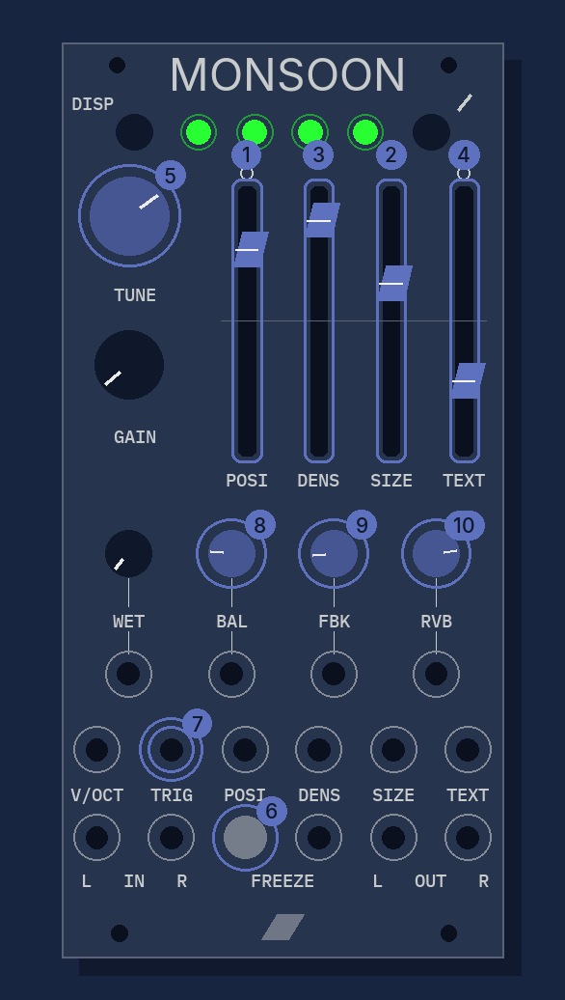

| Control | |
|---|---|
| ① POSITION | which space (8 zones, 30 ms crossfade) |
| ② SIZE | how much of the IR (shorter also saves CPU) |
| ③ DENSITY | pre-delay 0 → 200 ms |
| ④ TEXTURE | tilt on the wet sound, dark ↔ bright |
| ⑤ PITCH | wet filter: high-cut ← noon (full range) → low-cut |
| ⑥ FREEZE | input muted, the space loops back on itself forever |
| ⑦ TRIG | next space |
| ⑧ BAL | early ↔ late: noon = the IR as it is. Left: the tail fades away (close, dry). Right: the early part fades and the tail swells (far away). Same loudness |
| ⑨ FBK | feedback through the IR: the space builds on itself, longer and denser; it never howls (FREEZE is the endless version) |
| ⑩ RVB | a long smooth FDN tail (0.5 → 16 s) behind the space (the IRs are at most 170 ms) |

### Bank 2 (red)

#### 16 · QUELL — resonance suppressor
*Forecast: harsh peaks clearing by afternoon.*

A spectral dynamic EQ: it finds narrow ringing peaks standing above their
neighbours and pushes them down, stereo-linked so the image doesn't move
(27 ms latency). FFT 1024 (256–2048 with the FFT size setting, 3.8).

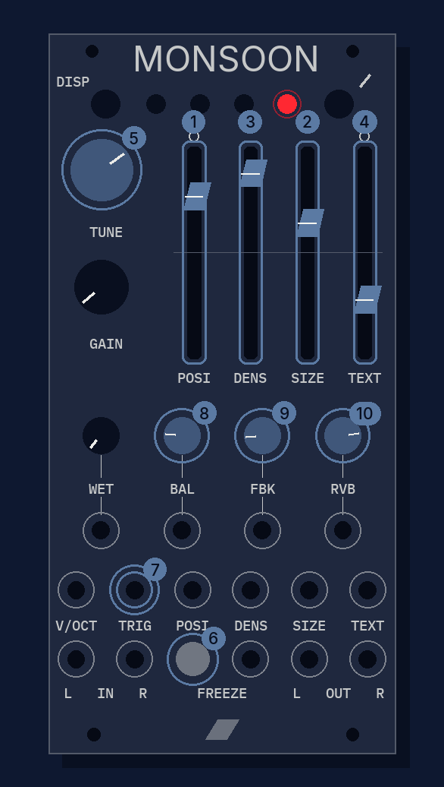

| Control | |
|---|---|
| ① POSITION | where it listens hardest, 100 Hz → 16 kHz |
| ② SIZE | selectivity: only sharp ringing → broad honky areas |
| ③ DENSITY | depth, up to 24 dB of cut (bottom = transparent) |
| ④ TEXTURE | speed: slow and smooth → fast |
| ⑤ PITCH | output trim ±12 dB |
| ⑥ FREEZE | hold the current cut curve as a static EQ |
| ⑦ TRIG | delta: hear only what's being removed |
| ⑧ BAL | noon = stereo-linked. Left: mid only (the sides pass untouched). Right: sides only |
| ⑨ FBK | hard threshold: anything louder than a level falling 0 → −72 dBFS is pushed down too; all the way up it squashes the spectrum flat (up to DENSITY's depth) |
| ⑩ RVB | halo: what's cut rings on as a soft spectral tail, 0.3 → 5 s (also heard in delta) |

#### 17 · LEITNER — spatial path panner (after Leitner / Xenakis)
*Forecast: the sound takes flight and circles your head.*

The input becomes a source flying along a path around you, with ear-delay,
head shadow, distance, air, Doppler and four reflections from a virtual
room. Works on headphones and speakers.

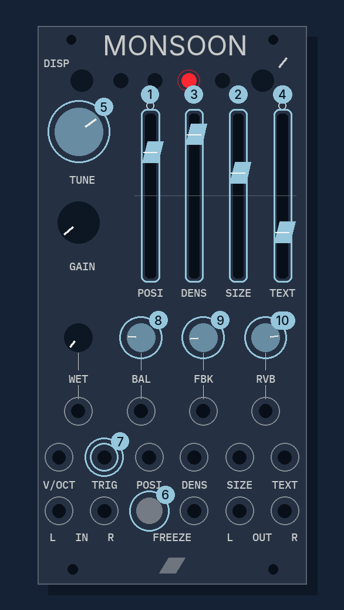

| Control | |
|---|---|
| ① POSITION | where the path is centred: noon = in front, ¾ = left, ¼ = right, ends = behind |
| ② SIZE | radius / distance, 1 → 10 m |
| ③ DENSITY | speed, 0.02 → 4 trips per second |
| ④ TEXTURE | room: open field → big room with strong reflections |
| ⑤ PITCH | Doppler: none ← physical (noon) → exaggerated ×3 |
| ⑥ FREEZE | stop moving; the source stays where it is |
| ⑦ TRIG | next path: circle → figure-8 → fly-by → spiral → random flight |
| ⑧ BAL | noon = a smooth glide. Left (Leitner): the path becomes 8 loudspeaker stations; the source rests at each and hops to the next. Right (Xenakis): every trip round the path takes a chance length |
| ⑨ FBK | trail: the sound is re-emitted every 150 ms from wherever the source has flown to, darker each time |
| ⑩ RVB | the room's late tail (the FDN reverb) |

#### 18 · TANTRI — tabla + tanpura
*Forecast: monsoon season in Varanasi.*

A tanpura drone with a curved jawari bridge, and a tabla pair you play with
TRIG. Your input also sets the strings and drum heads ringing.

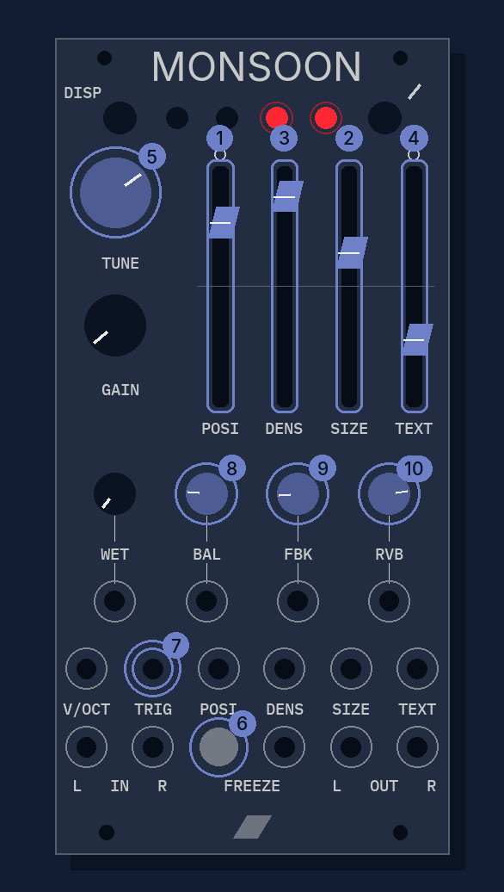

| Control | |
|---|---|
| ① POSITION | which stroke TRIG plays: Na · Tin · Tun · Te · Ge · Ke · Dha · Dhin |
| ② SIZE | bayan palm pressure: bends the bass drum up to +55 % (the "ghe" glide) |
| ③ DENSITY | tanpura: silent → louder and faster plucking (Pa Sa Sa sa, 30 → 90 per minute) |
| ④ TEXTURE | jawari: plain string → full buzzing bridge |
| ⑤ PITCH | Sa, V/OCT (C3 at noon); dayan sits at upper Sa, bayan below |
| ⑥ FREEZE | the drone sustains forever; plucking stops; the drums still play |
| ⑦ TRIG | play the stroke |
| ⑧ BAL | the tanpura's first string: left third Ma, noon Pa, right third Ni |
| ⑨ FBK | ring: the drum heads ring up to 5× longer, the closed strokes stop damping, and the drone sets the drums humming |
| ⑩ RVB | a room round the drums and the drone (the FDN reverb) |

#### 19 · HARMONIZER — scale harmonizer
*Forecast: a choir of you, always in key.*

Tracks your pitch and adds up to three voices exactly on scale degrees, even
if you're a little sharp.

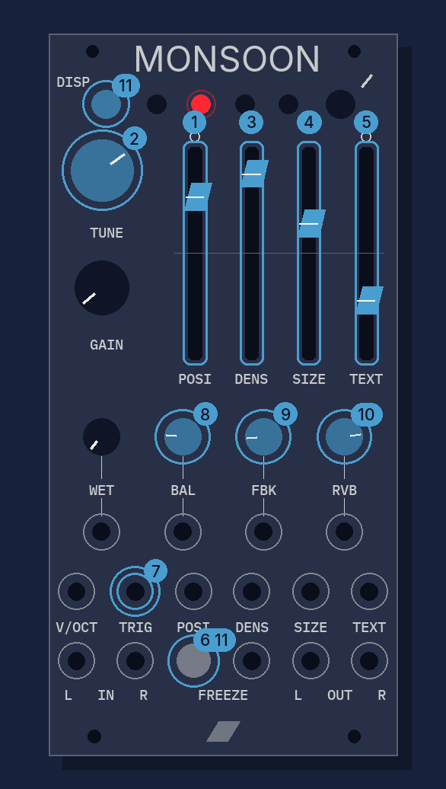

| Control | |
|---|---|
| ① POSITION | chord set: 3rd up · 5th up · 3rd+5th · octave up+down · 3rd below+above · 4th+7th · 3rd+5th+octave · 5th+9th+octave down |
| ② PITCH | the key, V/OCT (C at noon; each semitone moves the key) |
| ③ DENSITY | how many voices (1 → 3) and how loud |
| ④ SIZE | humanise: a little detune and delay per voice |
| ⑤ TEXTURE | stereo spread of the voices |
| ⑥ FREEZE | latch: the voices hold their notes while you carry on |
| ⑦ TRIG | next chord set |
| ⑧ BAL | register: left third every voice an octave down, right third an octave up (same chord shape) |
| ⑨ FBK | canon: the voices (not you) echo every 340 ms, darker each time |
| ⑩ RVB | glide: the voices slide into each new note, from a snap up to ~0.8 s |
| ⑪ Options | 1 major · 2 natural minor · 3 dorian · 4 major pentatonic |

#### 20 · PUTZ — spectral cleaner
*Forecast: hiss lifting, hum dispersing.*

A denoiser plus a 50/60 Hz hum comb. It learns the noise when you hold
FREEZE; until then it tracks the noise floor by itself (32 ms latency).
FFT 1024 (256–1024 with the FFT size setting, 3.8).

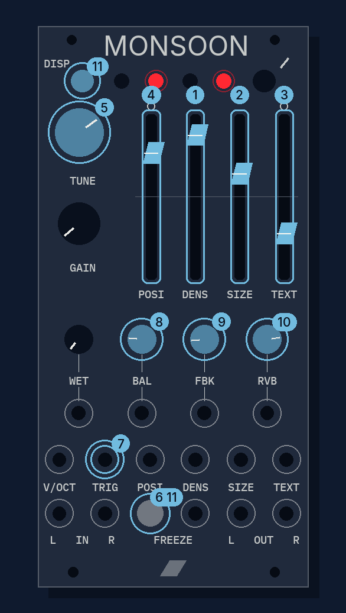

| Control | |
|---|---|
| ① DENSITY | reduction, up to 30 dB |
| ② SIZE | smoothing (fewer "musical noise" twitters) |
| ③ TEXTURE | transient protection: lets attacks through |
| ④ POSITION | hum comb depth (8 harmonics) |
| ⑤ PITCH | hum fundamental, ± one octave around 50/60 Hz |
| ⑥ FREEZE (hold) | learn the noise: play only the noise while holding |
| ⑦ TRIG | listen to what's removed |
| ⑧ BAL | noon = as before. Left: the lows are cleaned harder (rumble, room) and the highs left alone. Right: hiss only, the bass untouched |
| ⑨ FBK | de-crackle: clicks and vinyl crackle on the input are flattened, steady sound passes |
| ⑩ RVB | de-reverb: every tail dies up to 3× faster, attacks and held notes stay (works with DENSITY at 0 too) |
| ⑪ Options | 1 = 50 Hz mains · 2 = 60 Hz mains |

#### 21 · ENSEMBLE — string-machine ensemble
*Forecast: a 1970s string machine drifts in from the coast.*

Three modulated delay taps per side, a slow and a fast LFO at 120° steps:
the Solina shimmer.

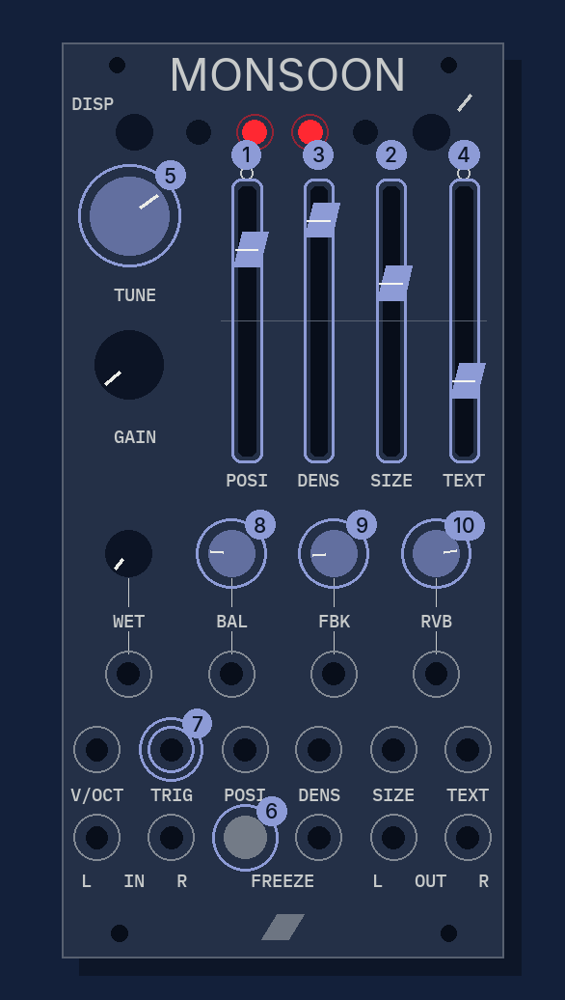

| Control | |
|---|---|
| ① POSITION | chorus → ensemble → vibrato |
| ② SIZE | base delay 5 → 15 ms |
| ③ DENSITY | modulation depth |
| ④ TEXTURE | clean hi-fi → dark bucket-brigade |
| ⑤ PITCH | LFO rate, V/OCT |
| ⑥ FREEZE | stop the LFOs where they are |
| ⑦ TRIG | reset the LFO phases |
| ⑧ BAL | noon = as before. Left: only the slow LFO, deeper (a pure swirl). Right: only the fast one, deeper (pure shimmer, even in chorus) |
| ⑨ FBK | regeneration: the taps go round again (with DENSITY low: flanger jets) |
| ⑩ RVB | reverb: the string machine's hall (the module's FDN reverb) |

#### 22 · BARBERPOLE — frequency-shift spirals
*Forecast: endlessly rising (or falling) and never arriving.*

A frequency shifter inside a feedback delay: every pass shifts again, so
echoes spiral up or down forever.

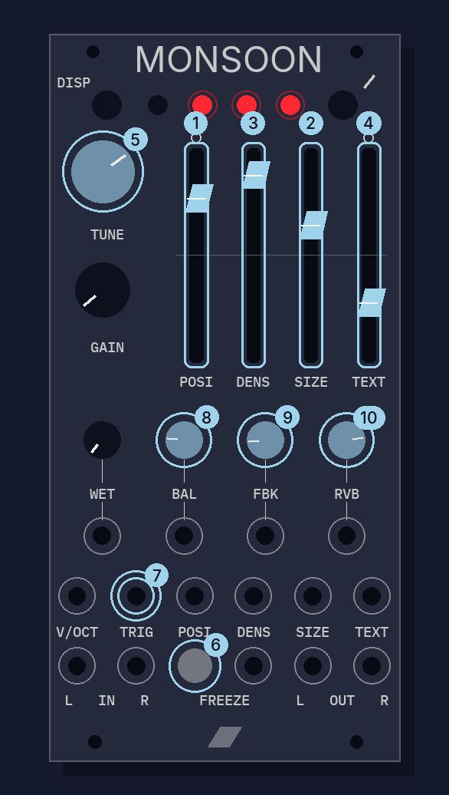

| Control | |
|---|---|
| ① POSITION | shift, bipolar: noon = none, up ↑ / down ↓, up to 2 kHz |
| ② SIZE | loop delay 1.5 ms → 0.5 s (up to 3 s at a lower buffer quality, 3.7) |
| ③ DENSITY | feedback |
| ④ TEXTURE | both sides the same way → left up, right down |
| ⑤ PITCH | multiplies the shift, V/OCT |
| ⑥ FREEZE | infinite spiral, input muted |
| ⑦ TRIG | flip direction |
| ⑧ BAL | noon = as before. Left: every pass darker (the loop closes to 1.2 kHz). Right: every pass thinner (opens up to 1.5 kHz) |
| ⑨ FBK | wow: the loop delay wobbles, so every pass is a little more out of tune, like tape |
| ⑩ RVB | dispersion: every pass drags the lows behind the highs, and the repeats melt into falling chirps, like a spring |

#### 23 · SPECDELAY — spectral delay
*Forecast: the lows arrive late, the highs early (or the other way round).*

Every frequency band has its own delay and feedback. FFT 512 (256–1024 with
the FFT size setting, 3.8: bigger means finer bands and longer steps).

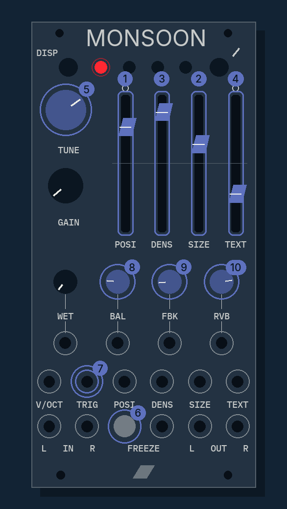

| Control | |
|---|---|
| ① POSITION | delay curve: lows last ← all together (noon) → highs last |
| ② SIZE | longest delay 5 ms → 0.5 s |
| ③ DENSITY | feedback |
| ④ TEXTURE | feedback tilt: dark repeats ← flat → thin bright repeats |
| ⑤ PITCH | spectral shift per repeat (±24 st): spirals; noon = none |
| ⑥ FREEZE | the spectral echoes hold forever |
| ⑦ TRIG | clear |
| ⑧ BAL | noon = as before. Left: stripes (neighbouring bands answer early and late). Right: scatter (every band gets its own random delay) |
| ⑨ FBK | blur: every repeat smears further across frequency, and tones widen into hiss |
| ⑩ RVB | diffusion: every repeat smears further in time, and the echoes melt into a wash |

#### 24 · CHOIR — formant choir
*Forecast: a choir on the horizon, singing whatever you hum.*

Four voices on a chord that follows V/OCT, each through vowel formants,
excited by your input and/or their own breath.

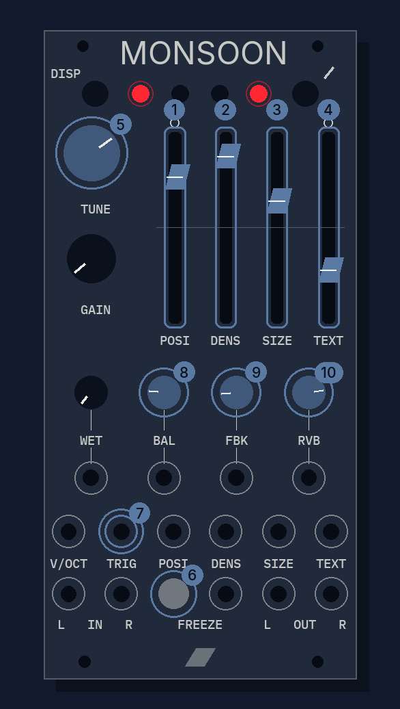

| Control | |
|---|---|
| ① POSITION | vowel a → e → i → o → u |
| ② DENSITY | chord: unison · fifths · major · minor · sus4 · dom7 |
| ③ SIZE | voice spread: detune, width, vibrato |
| ④ TEXTURE | the input pitched through the voices → their own glottal breath |
| ⑤ PITCH | chord root, V/OCT (C3 at noon) |
| ⑥ FREEZE | sustain the chord on their own breath, no input needed |
| ⑦ TRIG | next inversion |
| ⑧ BAL | noon = as before (altos). Left: bigger, darker singers (formants down). Right: smaller, brighter ones (formants up). The notes stay put |
| ⑨ FBK | resonance: your input rings on and sings its chord for seconds (TEXTURE left of full) |
| ⑩ RVB | reverb: a choir needs a church (the module's FDN reverb) |

#### 25 · FOLDER — wavefolder + low-pass gate
*Forecast: west-coast weather, with a breeze off the Pacific.*

A sine wavefolder (oversampled, clean) into a vactrol low-pass gate. Your
input and an internal sine get folded together, and your input's level or
TRIG opens the gate.

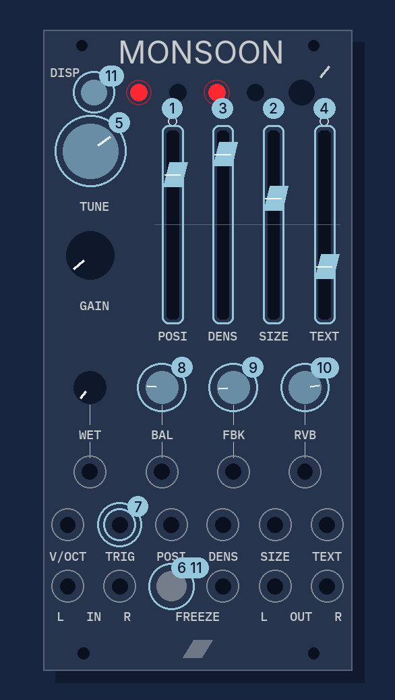

| Control | |
|---|---|
| ① POSITION | fold amount 1× → 10× |
| ② SIZE | symmetry: noon = odd harmonics, either side adds even ones |
| ③ DENSITY | gate type: low-pass → combo → VCA |
| ④ TEXTURE | vactrol decay 30 ms → 3 s |
| ⑤ PITCH | internal sine, V/OCT |
| ⑥ FREEZE | gate held open: a drone |
| ⑦ TRIG | ping the gate |
| ⑧ BAL | noon = as before. Left: your input bends the sine's phase (option 1). Right: the sine ring-modulates your input (in option 2 too: a ring mod at PITCH) |
| ⑨ FBK | the folder feeds itself: growl, then chaos |
| ⑩ RVB | reverb (the module's FDN reverb) |
| ⑪ Options | 1 input + sine · 2 input only (an effect) |

#### 26 · HALL — big reverb
*Forecast: cathedral conditions, visibility unlimited.*

A big eight-line reverb with diffusion inside every line: up to 30 seconds
of tail, separate from the output reverb.

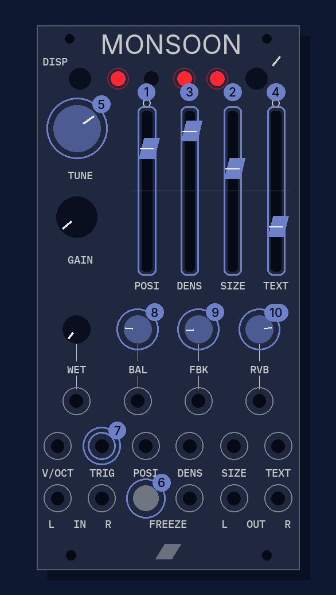

| Control | |
|---|---|
| ① POSITION | pre-delay 0 → 250 ms |
| ② SIZE | room size |
| ③ DENSITY | decay 0.4 → 30 s |
| ④ TEXTURE | damping: dark → bright |
| ⑤ PITCH | modulation: none ← gentle chorus (noon) → deep |
| ⑥ FREEZE | hold forever |
| ⑦ TRIG | clear the tail |
| ⑧ BAL | noon = as before. Left: the lows die sooner (bass decay down to ×0.25: a clear, airy hall). Right: the lows ring on (×3: warm and heavy) |
| ⑨ FBK | pre-delay echoes: the pre-delay repeats (time = POSITION), and every echo blooms into the hall. Nothing at POSITION 0 |
| ⑩ RVB | diffusion backs off: the smooth wash turns grainy and its echoes come apart, like a stone stairwell |

#### 27 · BLOOM — swells + reverse blooms
*Forecast: everything arrives backwards first, then gently.*

Each sound is heard reversed and swelling just before it arrives, then
arrives with its attack smoothed into a swell.

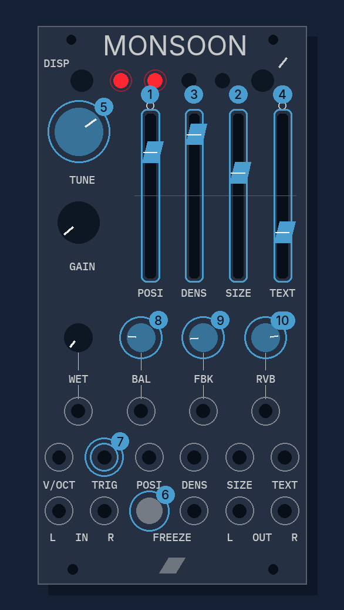

| Control | |
|---|---|
| ① POSITION | swell time: attacks untouched → ~2 s swell on every note |
| ② SIZE | reverse window 50 → 280 ms (the delay is twice this; up to 1.68 s at a lower buffer quality, 3.7) |
| ③ DENSITY | reverse-bloom level |
| ④ TEXTURE | diffusion: clean reverse → hazy reverse reverb |
| ⑤ PITCH | transposition of the reverse bloom (±12 st) |
| ⑥ FREEZE | the last window keeps blooming, over and over |
| ⑦ TRIG | restart the reverse heads now |
| ⑧ BAL | noon = as before. Left: more and more blooms fade out instead of in (reverse echoes that strike, then trail away). Right: more and more play forwards, swelling in, one window late |
| ⑨ FBK | regeneration (the module's feedback loop): every bloom blooms again (reversed twice = forwards again …) |
| ⑩ RVB | haze tail: the diffusion chain becomes a loop, so the blooms ring on after the note (reverse reverb → note → reverb) |

#### 28 · GAMELAN — metallophones
*Forecast: bronze rain, beating gently in pairs.*

Seven keys in pelog or slendro. Every key has a twin tuned a few hertz away,
so they beat (ombak).

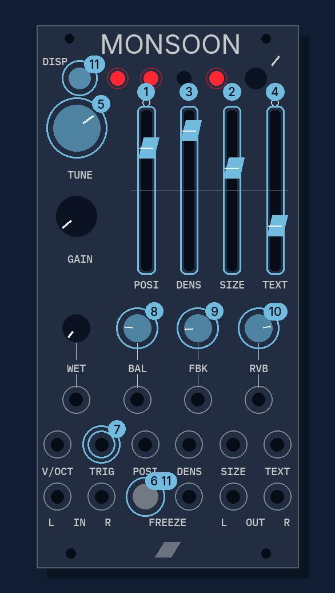

| Control | |
|---|---|
| ① POSITION | which key TRIG strikes |
| ② SIZE | ombak (beating) 0 → 10 Hz |
| ③ DENSITY | decay 0.3 → 20 s |
| ④ TEXTURE | saron bar → bonang kettle → gong (two octaves down) |
| ⑤ PITCH | root, V/OCT (C4 at noon) |
| ⑥ FREEZE | ring forever |
| ⑦ TRIG | strike |
| ⑧ BAL | mallet: noon = as before. Left: softer, padded (upper partials fade, round and dull). Right: harder (upper partials up to ×5). Shapes TRIG strikes |
| ⑨ FBK | tutup: on each strike the other hand chokes the key struck before (up to 60 dB in 60 ms). 0 = everything rings |
| ⑩ RVB | the pendopo: a reverb around the bank (the module's FDN reverb) |
| ⑪ Options | 1 pelog · 2 slendro |

#### 29 · MIRROR — spectral warping
*Forecast: the sky reflected in a puddle, upside down.*

Every partial is moved to a new frequency: stretched apart (bells),
mirrored around an anchor note (highs become lows), or folded under it.
FFT 1024 (256–2048 with the FFT size setting, 3.8).

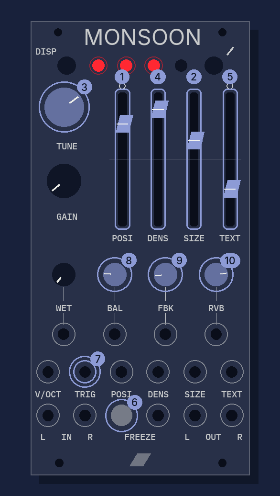

| Control | |
|---|---|
| ① POSITION | stretch → invert → fold |
| ② SIZE | amount: clean → full warp |
| ③ PITCH | the anchor / mirror note, V/OCT (C4 at noon) |
| ④ DENSITY | spectral blur |
| ⑤ TEXTURE | tilt, dark ↔ bright |
| ⑥ FREEZE | hold the spectrum (still warpable) |
| ⑦ TRIG | grab a new spectrum while frozen |
| ⑧ BAL | frequency shift: noon none, left down, right up, up to ±1 kHz. Every partial moves by the same Hz, so harmonic sounds turn inharmonic; below 0 Hz they reflect back up |
| ⑨ FBK | warp feedback: the warped spectrum is warped again and again. Partials spiral (stretch glides them away from the anchor, BAL slides them, fold piles them under it); with no warp it's a spectral sustain |
| ⑩ RVB | reverb (the module's FDN reverb; MIRROR's output is mono, the space comes from here) |

#### 30 · POLISH — mastering chain
*Forecast: clear, bright and finished.*

Tilt → 3-band compressor → tape saturation → width with mono bass (the
limiter follows). Zero latency, flat when everything is off.

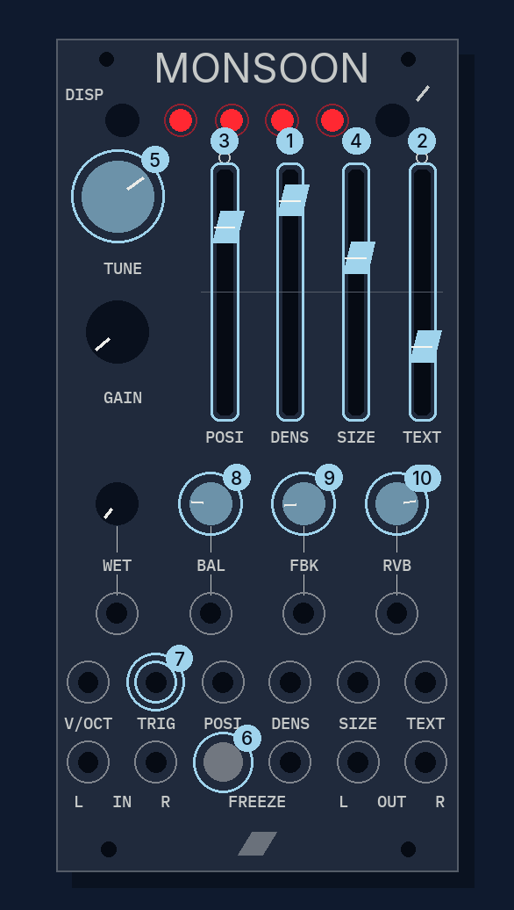

| Control | |
|---|---|
| ① DENSITY | compression amount (one macro for 3 bands, auto make-up) |
| ② TEXTURE | tape saturation: clean → warm and driven |
| ③ POSITION | tone: dark ← flat (noon) → bright |
| ④ SIZE | width: mono ← as is → 2× side; below 120 Hz always mono |
| ⑤ PITCH | output trim ±12 dB |
| ⑥ FREEZE | bypass, for A/B |
| ⑦ TRIG | auto-gain: match output loudness to input |
| ⑧ BAL | where the compressor leans: noon = as before. Left: the lows get squeezed harder (tight, dense bass). Right: the highs do (tames harshness) |
| ⑨ FBK | parallel ("New York") compression: a smashed copy under the mix. Quiet detail comes up, peaks stay |
| ⑩ RVB | air: new harmonics above 6 kHz, made from the highs (sparkle, not EQ) |


---

## 6. Under the cloud (specs)

| | |
|---|---|
| Sample rate | 48 kHz (Clouds: 32 kHz) |
| Processing | 32-bit float; buffers 16-bit (or 8-bit) mantissa + exponent per 32 samples, stored at 48, 24 or 16 kHz (buffer quality, 3.7) |
| Interpolation | Hermite everywhere it reads between samples |
| FFT | ARM CMSIS-DSP real FFT, heavy work between interrupts; 256–2048 points (FFT size, 3.8) |
| RAM per mode | about 130 KB (only the running mode holds memory) |
| CPU | every mode and option measured on an emulated STM32F405 (built with the firmware's own compiler flags) at ordinary settings, flat out and at all 16 panel corners: ≤ ~2200 instructions per stereo frame including the output section |
| Output | hard stereo, mono bass below 60 Hz (LR4, switchable), limiter, TPDF dither |
| Save slots | 4 × 128 KB of flash |
| Settings | calibration, mode, per-mode option + envelope routing, mono bass, buffer quality, FFT size |

The source, the 225 tests, the CPU benchmark and the emulator check live
in the repository: `make -C host test`, `tools/bench/run.sh`,
`tools/bench/verify.sh` (every mode and option on the emulated chip,
compared with the same run on a computer).

---

## 7. Thanks and licences

- **Mutable Instruments / Émilie Gillet**: Clouds, stmlib, the audio
  bootloader and its QPSK encoder (MIT).
- **Tom Burns**: the Monsoon port of the Clouds firmware, whose pin mapping
  this firmware stands on (MIT).
- **Jak Plugg**: the Monsoon hardware.
- **ARM**: CMSIS-DSP FFT (BSD-style licence, see `stmlib/third_party`).
- The Chloaelis, Tantri, Oneirophone, Quell, Leitner and ConvoSolution
  ideas come from their own projects; the DSP here is written for the M4.

Cirrostratus is MIT-licensed. Look up. ☁
